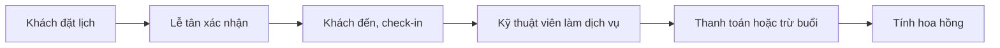

# Tổng quan nghiệp vụ — Quản lý Spa Salon

> Mô tả demo này cho ai, giải quyết vấn đề gì. Cập nhật khi phạm vi thay đổi.

---

## 1. Thông tin chung

| Mục | Nội dung |
| :--- | :--- |
| Tên demo | Quản lý Spa Salon |
| Mã dự án | `service-spa-salon` |
| Ngành / loại khách hàng | Spa, salon tóc, tiệm nail |
| Loại sản phẩm | Web quản lý + trang đặt lịch cho khách |
| Ý tưởng gốc | 3.1 · Spa / salon / nail (`ZDOCS/02-KE-HOACH/DANH-SACH-Y-TUONG.md`) |
| Người phụ trách | |
| Trạng thái | Có tài liệu nghiệp vụ (SRS, use case, kịch bản demo, kịch bản kiểm thử), chưa code |

## 2. Vấn đề của khách hàng

- Đặt lịch qua điện thoại, trùng giờ, trùng nhân viên
- Khách mua gói liệu trình, số buổi còn lại theo dõi bằng sổ
- Hoa hồng nhân viên tính tay cuối tháng

## 3. Giải pháp demo thể hiện

- Lịch hẹn dạng lưới theo nhân viên, kéo thả đổi giờ
- Khách tự đặt lịch online
- Dịch vụ, gói liệu trình, tự trừ buổi
- Thanh toán, hoa hồng theo dịch vụ, bảng hoa hồng tháng
- Hồ sơ khách và lịch sử sử dụng dịch vụ

## 4. Vai trò người dùng

| Vai trò | Mã | Dùng trên | Làm được gì |
| :--- | :--- | :--- | :--- |
| Khách | — | Điện thoại | Đặt lịch online |
| Quản trị viên | ADMIN | Desktop | Toàn quyền |
| Chủ tiệm | MANAGER | Desktop | Dịch vụ, gói, hoa hồng, báo cáo |
| Lễ tân | STAFF | Tablet | Lịch hẹn, check-in, thanh toán |
| Kỹ thuật viên | TECHNICIAN | Điện thoại | Xem lịch và hoa hồng của mình |

## 5. Phân hệ và chức năng

| Area | Chức năng | Màn hình (route FE dự kiến) | Ưu tiên |
| :--- | :--- | :--- | :---: |
| `System` | Đăng nhập, tài khoản, vai trò, cài đặt | Có sẵn | — |
| `Booking` | Tổng quan trong ngày | `/dashboard` | P1 |
| `Booking` | Lịch hẹn theo nhân viên | `/appointments` | P1 |
| `Booking` | Đặt lịch online | `/dat-lich` | P1 |
| `Booking` | Khách tra cứu, hủy lịch đã đặt | `/dat-lich/tra-cuu` | P2 |
| `Booking` | Dịch vụ, bảng giá | `/services` | P1 |
| `Booking` | Gói liệu trình, trừ buổi | `/packages` | P1 |
| `Booking` | Thanh toán | `/appointments/[id]` | P1 |
| `Hr` | Nhân viên, lịch làm việc, giờ mở cửa | `/staff` | P1 |
| `Hr` | Hoa hồng nhân viên | `/commissions` | P1 |
| `Hr` | Lịch và hoa hồng của tôi (kỹ thuật viên) | `/my-schedule` | P2 |
| `Crm` | Hồ sơ khách | `/customers` | P2 |
| `Booking` | Báo cáo doanh thu | `/reports` | P2 |

P1 = bắt buộc có để demo · P2 = nên có · P3 = làm thêm nếu còn thời gian.

## 6. Luồng nghiệp vụ chính

## 7. Phạm vi

**Có trong demo:**

- Lịch hẹn, đặt lịch online, gói liệu trình, hoa hồng

**Không làm (nói rõ với khách nếu được hỏi):**

- Gửi SMS, Zalo nhắc lịch thật
- Các kết nối bên ngoài khác chỉ giả lập

## 8. Dữ liệu mẫu cần chuẩn bị

| Dữ liệu | Số lượng | Ghi chú |
| :--- | :---: | :--- |
| Dịch vụ | 30 |  |
| Gói liệu trình | 8 |  |
| Nhân viên | 8 |  |
| Khách hàng | 200 |  |
| Lịch hẹn | ~1.200 | 90 ngày và 14 ngày tới |
