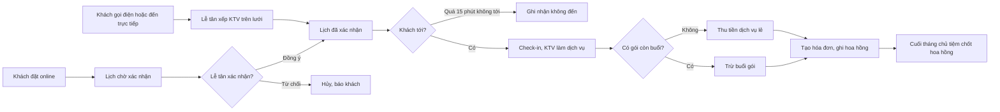
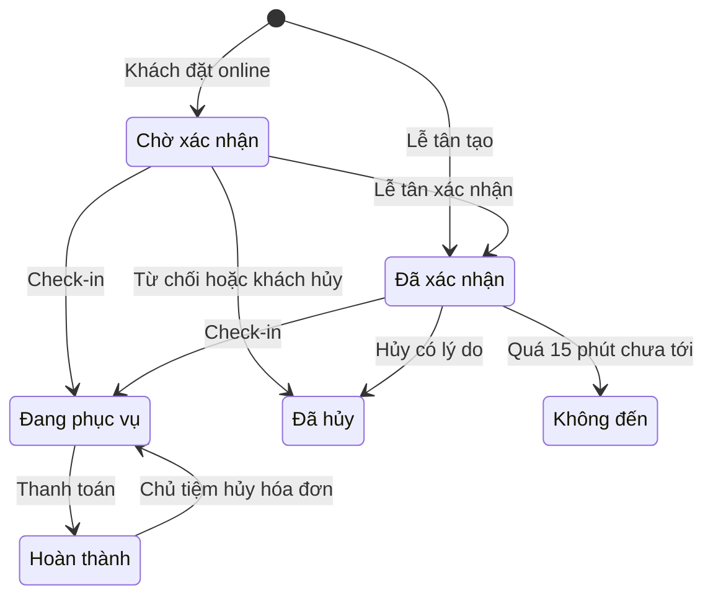
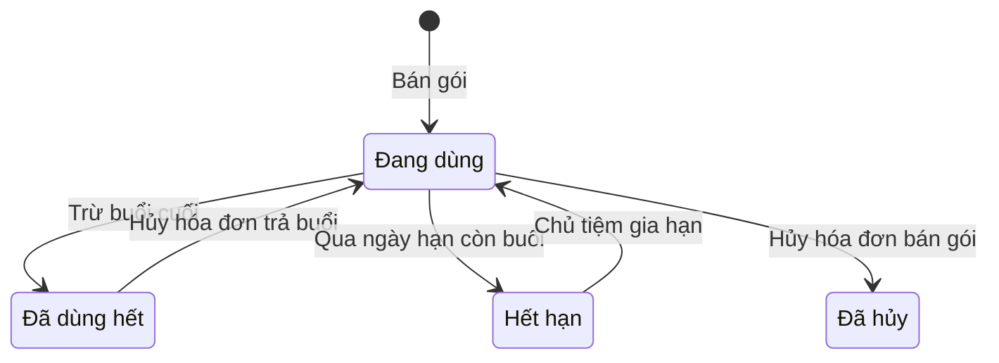
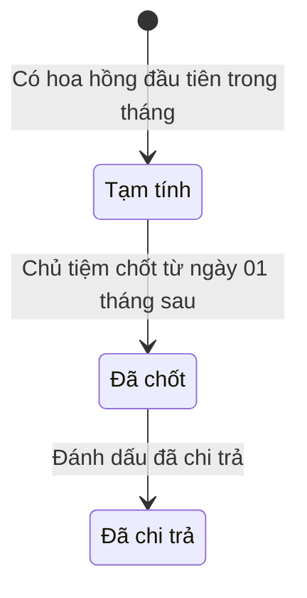

# Đặc tả yêu cầu phần mềm (SRS) — Quản lý Spa Salon

| Phiên bản | Ngày | Trạng thái |
| :--- | :--- | :--- |
| 1.0 | 12/10/2026 | Bản nháp để triển khai demo |

> Cách viết, quy ước mã, mức độ chi tiết: `ZDOCS/05-HUONG-DAN/HUONG-DAN-VIET-TAI-LIEU-NGHIEP-VU.md`.
> Phần nền (đăng nhập, tài khoản, vai trò, cài đặt, đặt lại dữ liệu demo): `ZDOCS/03-KIEN-TRUC/USE-CASE-NEN.md`, không viết lại ở đây.

---

## 1. Giới thiệu

### 1.1. Mục đích

Tài liệu mô tả đầy đủ yêu cầu của bản demo Quản lý Spa Salon: chức năng, quy tắc xếp lịch và chống trùng, cách trừ buổi gói liệu trình, cách tính hoa hồng, dữ liệu, báo cáo, phân quyền và màn hình. Dev dùng để code, tester dùng để viết và chạy test case, sales dùng để biết demo làm được gì.

### 1.2. Phạm vi

**Trong phạm vi:** dịch vụ và bảng giá, nhân viên và lịch làm việc theo ca, lịch hẹn dạng lưới theo kỹ thuật viên (tạo, kéo thả đổi giờ, xác nhận, hủy, check-in, ghi nhận không đến), trang đặt lịch online và tự hủy cho khách, thanh toán (tiền mặt, chuyển khoản QR, thẻ), gói liệu trình (bán gói, trừ buổi, hạn dùng), hoa hồng kỹ thuật viên và bảng hoa hồng tháng, hồ sơ khách, tổng quan và báo cáo.

**Ngoài phạm vi:** gửi SMS, Zalo thật (chỉ ghi nhật ký tin nhắn giả lập), cổng thanh toán và máy quẹt thẻ thật, quản lý phòng và giường, bán mỹ phẩm và tồn kho, thẻ trả trước nạp tiền, đặt cọc khi đặt lịch, chấm công và lương cứng, nhiều chi nhánh, hóa đơn điện tử.

### 1.3. Thuật ngữ

| Thuật ngữ | Giải thích |
| :--- | :--- |
| Dịch vụ | Một lần làm cho khách, có thời lượng và giá, vd "Massage body đá nóng" 90 phút |
| Thời lượng | Số phút kỹ thuật viên làm dịch vụ |
| Thời gian dọn | Số phút sau dịch vụ để dọn giường, chuẩn bị khách sau; kỹ thuật viên không nhận khách trong thời gian này |
| Kỹ thuật viên (KTV) | Nhân viên trực tiếp làm dịch vụ |
| Ca làm | Khung giờ KTV có mặt trong ngày: ca sáng, ca chiều, cả ngày |
| Lịch hẹn | Một lần khách đến tiệm, gồm một hoặc nhiều dòng dịch vụ |
| Dòng dịch vụ | Một dịch vụ trong lịch hẹn, có KTV, giờ bắt đầu, giờ kết thúc |
| Khoảng chiếm chỗ | Khoảng từ giờ bắt đầu tới giờ kết thúc cộng thời gian dọn của một dòng dịch vụ trên lịch KTV |
| Check-in | Lễ tân ghi nhận khách đã tới, lịch hẹn chuyển "Đang phục vụ" |
| Không đến | Khách không tới và không báo hủy |
| Gói mẫu | Gói liệu trình tiệm đang bán, vd "Chăm sóc da cơ bản 10 buổi" |
| Gói của khách | Gói khách đã mua, có số buổi còn lại và hạn dùng |
| Trừ buổi | Dùng một buổi trong gói của khách thay cho trả tiền dịch vụ |
| Giá trị một buổi | Giá gói chia cho số buổi |
| Dịch vụ lẻ | Dòng dịch vụ khách trả tiền, không trừ buổi |
| Hoa hồng dịch vụ | Tiền KTV nhận cho mỗi dòng dịch vụ đã làm (tiền tua) |
| Hoa hồng bán gói | Tiền người tư vấn nhận khi khách mua gói |
| Bảng hoa hồng tháng | Tổng hợp hoa hồng của mọi nhân viên trong một tháng |
| Thực thu | Tiền thật thu từ khách, gồm tiền dịch vụ lẻ và tiền bán gói |
| Giá trị dịch vụ đã làm | Tổng giá các dòng dịch vụ đã thanh toán; dòng trừ buổi tính theo giá trị một buổi |
| Tỉ lệ lấp lịch | Phần trăm thời gian ca làm của KTV có khách |

### 1.4. Tài liệu liên quan

| Tài liệu | Nội dung |
| :--- | :--- |
| `01-TONG-QUAN-NGHIEP-VU.md` | Tổng quan nghiệp vụ |
| `03-USE-CASE.md` | Đặc tả use case |
| `05-KICH-BAN-KIEM-THU.md` | Test case nghiệm thu |
| `ZDOCS/03-KIEN-TRUC/USE-CASE-NEN.md` | Phần nền dùng chung |

---

## 2. Mô tả tổng quan

### 2.1. Bối cảnh sản phẩm

Spa, salon tóc, tiệm nail có 4–10 kỹ thuật viên và 1–2 lễ tân, một chi nhánh. Lễ tân dùng tablet ở quầy để nhận lịch qua điện thoại, Zalo, Facebook, xếp KTV, check-in và thu tiền. Chủ tiệm dùng máy tính để quản lý dịch vụ, gói, lịch làm việc, hoa hồng và báo cáo. KTV dùng điện thoại riêng để xem lịch và hoa hồng của mình. Khách tự đặt lịch qua link gắn trên fanpage, Google Maps, Zalo OA.

### 2.2. Tác nhân

| Mã vai trò | Tên | Thiết bị | Mục tiêu khi dùng hệ thống |
| :--- | :--- | :--- | :--- |
| `ADMIN` | Quản trị viên | Desktop | Cấu hình hệ thống, tài khoản, phân quyền |
| `MANAGER` | Chủ tiệm | Desktop | Dịch vụ, gói, lịch làm việc KTV, giảm giá lớn, hủy hóa đơn, chốt hoa hồng, xem báo cáo |
| `STAFF` | Lễ tân | Tablet ngang | Nhận lịch, xếp KTV không trùng, check-in, thu tiền, bán gói |
| `TECHNICIAN` | Kỹ thuật viên | Điện thoại | Biết hôm nay làm cho ai, lúc nào; theo dõi hoa hồng của mình |
| — | Khách | Điện thoại | Xem dịch vụ, tự đặt lịch, tra cứu và hủy lịch, không cần đăng nhập |

Tài khoản demo: `admin`, `quanly`, `nhanvien` (Lễ tân), `kythuatvien` (liên kết với KTV Lê Hoàng Yến). Vai trò `STAFF` của phần nền hiển thị tên "Lễ tân".

### 2.3. Quy trình nghiệp vụ

### 2.4. Giả định và ràng buộc

- Một chi nhánh. Giờ mở cửa mặc định 09:00–21:00 mọi ngày, chủ tiệm đổi được.
- Không quản lý phòng, giường: số khách phục vụ cùng lúc chỉ giới hạn bởi số KTV rảnh.
- Giá dịch vụ, giá gói là bội số 1.000 ₫. Mỗi gói mẫu áp cho đúng một dịch vụ.
- Mỗi KTV liên kết tối đa một tài khoản đăng nhập vai trò `TECHNICIAN`.
- Tin nhắn xác nhận, nhắc lịch, hủy lịch là giả lập: nội dung ghi vào nhật ký tin nhắn của lịch hẹn, không gửi SMS, Zalo thật.
- QR chuyển khoản là ảnh giả lập theo định dạng VietQR, lễ tân tự bấm xác nhận. Thanh toán thẻ chỉ ghi nhận mã chuẩn chi, không kết nối máy POS ngân hàng.
- Gói trả đủ một lần, không trả góp.
- Hoa hồng tính trong hệ thống để tham khảo khi trả lương, không tính lương cứng.

---

## 3. Yêu cầu chức năng

### 3.1. Tổng quan

| Mã | Yêu cầu | Ưu tiên | Vai trò | UC |
| :--- | :--- | :---: | :--- | :--- |
| FR-01 | Hệ thống hiển thị trên Tổng quan số lịch hẹn hôm nay theo trạng thái (chờ xác nhận, đã xác nhận, đang phục vụ, hoàn thành, không đến), thực thu hôm nay và số khách mới trong ngày | P1 | MANAGER, STAFF | UC-14 |
| FR-02 | Tổng quan có danh sách lịch hẹn bắt đầu trong 2 giờ tới và danh sách lịch online đang chờ xác nhận; bấm một dòng mở chi tiết lịch hẹn | P1 | MANAGER, STAFF | UC-14 |

### 3.2. Dịch vụ và gói mẫu

| Mã | Yêu cầu | Ưu tiên | Vai trò | UC |
| :--- | :--- | :---: | :--- | :--- |
| FR-03 | Hệ thống cho phép chủ tiệm thêm, sửa, ẩn/hiện nhóm dịch vụ và dịch vụ với mã, tên, nhóm, thời lượng, thời gian dọn, giá, mô tả, ảnh, cho đặt online hay không, kiểu và mức hoa hồng | P1 | MANAGER | UC-01 |
| FR-04 | Hệ thống cho phép chủ tiệm thêm, sửa, ngừng bán gói mẫu với mã, tên, dịch vụ áp dụng, số buổi, giá gói, hạn dùng (tháng), khoảng cách tối thiểu giữa hai buổi (ngày), tỉ lệ hoa hồng bán gói; màn hình hiện giá lẻ tương đương và phần trăm tiết kiệm | P1 | MANAGER | UC-01 |

### 3.3. Nhân viên và lịch làm việc

| Mã | Yêu cầu | Ưu tiên | Vai trò | UC |
| :--- | :--- | :---: | :--- | :--- |
| FR-05 | Hệ thống cho phép chủ tiệm thêm, sửa hồ sơ nhân viên: mã, họ tên, số điện thoại, loại (KTV, lễ tân), màu hiển thị trên lịch, dịch vụ làm được (với KTV), tài khoản đăng nhập liên kết, trạng thái đang làm hoặc nghỉ việc | P1 | MANAGER | UC-02 |
| FR-06 | Hệ thống cho phép chủ tiệm đặt lịch làm việc tuần cho từng KTV (ca sáng, ca chiều, cả ngày hoặc nghỉ cho mỗi thứ) và đăng ký ngày nghỉ đột xuất | P1 | MANAGER | UC-02 |
| FR-07 | Hệ thống cho phép chủ tiệm đổi giờ mở cửa, giờ đóng cửa và khai báo ngày tiệm nghỉ (lễ, Tết) | P2 | MANAGER | UC-02 |

### 3.4. Lịch hẹn

| Mã | Yêu cầu | Ưu tiên | Vai trò | UC |
| :--- | :--- | :---: | :--- | :--- |
| FR-08 | Màn Lịch hẹn hiển thị lưới theo ngày: mỗi cột là một KTV có ca trong ngày, mỗi hàng là mốc 15 phút từ giờ mở tới giờ đóng cửa; khối dịch vụ ghi tên khách, tên dịch vụ, màu theo trạng thái; giờ ngoài ca tô xám; có vạch giờ hiện tại | P1 | STAFF, MANAGER | UC-03 |
| FR-09 | Lễ tân tạo lịch hẹn: tìm khách theo số điện thoại hoặc thêm nhanh khách mới, thêm 1–5 dòng dịch vụ, mỗi dòng chọn KTV và giờ bắt đầu, chọn nguồn (Điện thoại, Vãng lai, Zalo/Facebook); hệ thống tự tính giờ kết thúc | P1 | STAFF | UC-03 |
| FR-10 | Khi chọn KTV và giờ, hệ thống kiểm tra ngay trùng lịch KTV, ca làm, kỹ năng, giờ mở cửa và trùng lịch của khách; vi phạm thì chặn lưu và nêu rõ lý do | P1 | STAFF | UC-03, UC-05 |
| FR-11 | Hệ thống gợi ý các KTV rảnh làm được dịch vụ tại giờ đã chọn, và 3 giờ trống gần nhất của KTV đang chọn | P2 | STAFF | UC-03 |
| FR-12 | Lễ tân xác nhận hoặc từ chối (có lý do) lịch đặt online; lịch chờ xác nhận quá 30 phút được tô nổi trên lưới và Tổng quan | P1 | STAFF | UC-05 |
| FR-13 | Lễ tân kéo thả khối dịch vụ trên lưới sang giờ khác hoặc cột KTV khác; hệ thống kiểm tra lại như FR-10, vi phạm thì trả khối về chỗ cũ và báo lý do | P1 | STAFF | UC-05 |
| FR-14 | Lễ tân hủy lịch hẹn với lý do (Khách báo hủy, Tiệm đổi lịch, Khác kèm ghi chú); lịch hủy rời khỏi lưới nhưng vẫn tra được trong hồ sơ khách | P1 | STAFF | UC-05 |
| FR-15 | Lễ tân check-in khi khách tới, lịch hẹn chuyển "Đang phục vụ"; trong lúc phục vụ, lễ tân thêm dịch vụ phát sinh hoặc bỏ dòng dịch vụ chưa làm | P1 | STAFF | UC-07 |
| FR-16 | Lễ tân đánh dấu "Không đến" cho lịch quá giờ bắt đầu 15 phút chưa check-in; cuối ngày hệ thống tự đánh dấu các lịch còn lại | P2 | STAFF | UC-07 |
| FR-17 | Hệ thống ghi tin xác nhận, tin đổi lịch, tin hủy và tin nhắc trước 2 giờ vào nhật ký tin nhắn của lịch hẹn (giả lập SMS/Zalo) | P3 | Hệ thống | UC-05 |

### 3.5. Đặt lịch online

| Mã | Yêu cầu | Ưu tiên | Vai trò | UC |
| :--- | :--- | :---: | :--- | :--- |
| FR-18 | Trang đặt lịch công khai, không cần đăng nhập, gồm 4 bước: chọn dịch vụ (tối đa 3), chọn KTV hoặc "Bất kỳ ai", chọn ngày và giờ, nhập họ tên, số điện thoại, ghi chú | P1 | Khách | UC-04 |
| FR-19 | Bước chọn giờ chỉ hiện mốc còn trống thật theo lịch KTV, ca làm, giờ mở cửa và quy tắc đặt trước; mốc cách nhau 30 phút | P1 | Khách | UC-04 |
| FR-20 | Đặt xong, khách thấy mã lịch hẹn, dịch vụ, KTV, giờ bắt đầu và kết thúc dự kiến, tổng tiền dự kiến, trạng thái "Chờ xác nhận"; hệ thống ghép hồ sơ khách theo số điện thoại hoặc tạo hồ sơ mới | P1 | Khách | UC-04 |
| FR-21 | Khách tra cứu lịch đã đặt bằng mã lịch hẹn và số điện thoại, tự hủy khi còn ít nhất 2 giờ trước giờ hẹn | P2 | Khách | UC-06 |

### 3.6. Thanh toán

| Mã | Yêu cầu | Ưu tiên | Vai trò | UC |
| :--- | :--- | :---: | :--- | :--- |
| FR-22 | Ở chi tiết lịch hẹn "Đang phục vụ", lễ tân bấm "Thanh toán"; hệ thống liệt kê các dòng dịch vụ kèm KTV và giá, dòng nào khách có gói hợp lệ thì tự bật "Trừ buổi" (lễ tân tắt được) | P1 | STAFF | UC-08 |
| FR-23 | Khi hóa đơn thanh toán, hệ thống trừ một buổi của gói cho mỗi dòng "Trừ buổi" và ghi lịch sử dùng gói (ngày, lịch hẹn, KTV) | P1 | STAFF | UC-08 |
| FR-24 | Lễ tân giảm giá hóa đơn theo phần trăm hoặc số tiền, chọn lý do, trong hạn mức của vai trò | P2 | STAFF, MANAGER | UC-08 |
| FR-25 | Lễ tân thu tiền mặt (nhập tiền khách đưa, hiện tiền thối), chuyển khoản (QR giả lập, bấm "Đã nhận tiền") hoặc thẻ (nhập mã chuẩn chi); hệ thống tạo hóa đơn và mở bản in khổ 80 mm | P1 | STAFF | UC-08 |
| FR-26 | Chủ tiệm hủy hóa đơn có lý do; hệ thống trả lại buổi gói đã trừ, xóa hoa hồng của hóa đơn, đưa lịch hẹn về "Đang phục vụ" | P2 | MANAGER | UC-10 |

### 3.7. Gói của khách

| Mã | Yêu cầu | Ưu tiên | Vai trò | UC |
| :--- | :--- | :---: | :--- | :--- |
| FR-27 | Lễ tân bán gói cho khách (bán riêng ở màn Gói liệu trình hoặc bán kèm khi thanh toán lịch hẹn), chọn người tư vấn; hệ thống tạo gói của khách với số buổi, ngày mua, hạn dùng | P1 | STAFF | UC-09 |
| FR-28 | Lễ tân và chủ tiệm xem danh sách gói của khách, lọc theo trạng thái, gói hết hạn trong 30 ngày tới, gói còn 1 buổi; xem lịch sử trừ buổi từng gói | P1 | STAFF, MANAGER | UC-09 |
| FR-29 | Chủ tiệm gia hạn gói của khách một lần, tối đa 60 ngày, có lý do | P3 | MANAGER | UC-16 |

### 3.8. Hoa hồng

| Mã | Yêu cầu | Ưu tiên | Vai trò | UC |
| :--- | :--- | :---: | :--- | :--- |
| FR-30 | Hệ thống tự ghi hoa hồng dịch vụ cho KTV ở từng dòng dịch vụ và hoa hồng bán gói cho người tư vấn khi hóa đơn thanh toán | P1 | Hệ thống | UC-08, UC-11 |
| FR-31 | Chủ tiệm xem bảng hoa hồng theo tháng: mỗi nhân viên một dòng gồm số lượt dịch vụ, doanh số tính hoa hồng, hoa hồng dịch vụ, số gói bán, hoa hồng bán gói, tổng; mở chi tiết từng dòng hoa hồng | P1 | MANAGER | UC-11 |
| FR-32 | Chủ tiệm chốt bảng hoa hồng tháng và đánh dấu đã chi trả; tháng đã chốt không thay đổi được | P2 | MANAGER | UC-11 |
| FR-33 | KTV xem trên điện thoại lịch của mình theo ngày (giờ, tên khách, dịch vụ, ghi chú của khách) và hoa hồng tạm tính tháng này | P2 | TECHNICIAN | UC-12 |

### 3.9. Khách hàng

| Mã | Yêu cầu | Ưu tiên | Vai trò | UC |
| :--- | :--- | :---: | :--- | :--- |
| FR-34 | Lễ tân và chủ tiệm xem, thêm, sửa hồ sơ khách: số điện thoại, họ tên, ngày sinh, giới tính, ghi chú tình trạng da, dị ứng; xem lịch sử lịch hẹn, gói đang có, tổng chi tiêu, số lần không đến | P2 | STAFF, MANAGER | UC-13 |
| FR-35 | Hệ thống gắn nhãn "Hay bỏ hẹn" cho khách theo BR-13 và hiện cảnh báo khi lễ tân tạo hoặc xác nhận lịch của khách đó | P2 | STAFF | UC-03, UC-13 |

### 3.10. Báo cáo

| Mã | Yêu cầu | Ưu tiên | Vai trò | UC |
| :--- | :--- | :---: | :--- | :--- |
| FR-36 | Báo cáo doanh thu theo ngày: thực thu (tách dịch vụ lẻ và bán gói), giá trị dịch vụ đã làm, số hóa đơn, giảm giá; so với kỳ liền trước cùng độ dài | P2 | MANAGER | UC-15 |
| FR-37 | Báo cáo theo dịch vụ (số lượt, giá trị, số lượt trừ buổi) và theo KTV (số lượt, giá trị dịch vụ đã làm, tỉ lệ lấp lịch, hoa hồng) | P2 | MANAGER | UC-15 |
| FR-38 | Báo cáo tỉ lệ hủy, không đến, nguồn đặt lịch; xuất báo cáo đang xem ra file Excel | P3 | MANAGER | UC-15 |

---

## 4. Quy tắc nghiệp vụ

| Mã | Quy tắc | Áp dụng cho |
| :--- | :--- | :--- |
| BR-01 | Giờ mở cửa mặc định 09:00–21:00. Mọi dòng dịch vụ bắt đầu từ giờ mở cửa và kết thúc chậm nhất lúc đóng cửa. Giờ bắt đầu theo bước 15 phút (:00, :15, :30, :45) và không sớm hơn mốc 15 phút hiện tại (lúc 10:07 chọn được từ 10:00). Ngày tiệm nghỉ không đặt được lịch | FR-07, FR-09, FR-19 |
| BR-02 | Thời lượng dịch vụ là bội số 15 phút, từ 15 đến 240 phút. Thời gian dọn là bội số 5 phút, từ 0 đến 30 phút, mặc định 10 phút. Giờ kết thúc = giờ bắt đầu + thời lượng. Khoảng chiếm chỗ = [giờ bắt đầu, giờ kết thúc + thời gian dọn); thời gian dọn được phép kéo qua giờ đóng cửa | FR-03, FR-09 |
| BR-03 | Một KTV không có hai dòng dịch vụ có khoảng chiếm chỗ giao nhau. Hai khoảng [a1, b1) và [a2, b2) giao nhau khi a1 < b2 và a2 < b1; chạm mép không tính trùng. Chỉ xét dòng thuộc lịch "Chờ xác nhận", "Đã xác nhận", "Đang phục vụ", "Hoàn thành". Vd KTV làm "Chăm sóc da cơ bản" 14:00–15:00, dọn 10 phút thì bận tới 15:10; lịch mới lúc 15:00 bị chặn, lúc 15:15 được | FR-10, FR-13, FR-19 |
| BR-04 | Dòng dịch vụ phải nằm trọn trong ca của KTV ngày đó (không tính thời gian dọn), KTV không có ngày nghỉ đột xuất trùng ngày đó và có dịch vụ đó trong danh sách làm được. Ca sáng: giờ mở cửa–15:00; ca chiều: 15:00–giờ đóng cửa; cả ngày: giờ mở cửa–giờ đóng cửa | FR-06, FR-10 |
| BR-05 | Một khách không có hai lịch hẹn khác nhau chồng giờ, tính từ giờ bắt đầu sớm nhất tới giờ kết thúc muộn nhất của mỗi lịch. Trong một lịch hẹn, các dòng mặc định nối tiếp nhau; hai dòng được chạy song song khi do hai KTV khác nhau làm (vd sơn gel tay và chân cùng lúc) | FR-10 |
| BR-06 | Đặt online: giờ bắt đầu cách lúc đặt ít nhất 2 giờ và trong vòng 30 ngày; tối đa 3 dịch vụ, làm nối tiếp; một số điện thoại có tối đa 2 lịch online chưa diễn ra ở trạng thái "Chờ xác nhận" hoặc "Đã xác nhận". Dịch vụ chỉ hiện trên trang đặt online khi đang hiển thị, bật "Cho đặt online" và có ít nhất một KTV đang làm việc làm được | FR-18, FR-19 |
| BR-07 | Khách chọn "Bất kỳ ai": hệ thống ưu tiên một KTV làm được tất cả dịch vụ đã chọn liền mạch; trong các KTV phù hợp, chọn người có tổng thời lượng đã xếp trong ngày ít nhất (tính mọi dòng còn chiếm chỗ), bằng nhau thì theo mã nhân viên tăng dần. Không có ai làm được tất cả thì gán từng dòng theo cùng quy tắc | FR-18, FR-19 |
| BR-08 | Lịch đặt online vào trạng thái "Chờ xác nhận" và giữ chỗ ngay. Chờ quá 30 phút chưa xử lý thì tô cam trên lưới và Tổng quan. Lịch do lễ tân tạo vào thẳng "Đã xác nhận" | FR-12, FR-20 |
| BR-09 | Chỉ đổi giờ, đổi KTV (kể cả kéo thả) cho lịch "Chờ xác nhận" hoặc "Đã xác nhận"; kiểm tra lại BR-01 đến BR-05. Lịch "Đang phục vụ" chỉ đổi được KTV hoặc giờ của dòng chưa tới giờ bắt đầu. Lịch "Hoàn thành", "Đã hủy", "Không đến" không đổi được | FR-13 |
| BR-10 | Lễ tân hủy được lịch "Chờ xác nhận" hoặc "Đã xác nhận", bắt buộc có lý do. Khách tự hủy online khi giờ bắt đầu còn cách ít nhất 2 giờ; dưới 2 giờ trang tra cứu ẩn nút hủy và hiện số hotline. Lịch hủy không chiếm chỗ KTV | FR-14, FR-21 |
| BR-11 | Chỉ check-in lịch của ngày hôm nay ở trạng thái "Chờ xác nhận" hoặc "Đã xác nhận"; check-in lịch "Chờ xác nhận" thì hệ thống xác nhận luôn | FR-15 |
| BR-12 | Lễ tân đánh dấu "Không đến" khi đã quá giờ bắt đầu sớm nhất của lịch 15 phút mà chưa check-in. Lúc 23:59 hằng ngày hệ thống tự chuyển các lịch chưa check-in của ngày đó sang "Không đến". Lịch không đến không chiếm chỗ KTV | FR-16 |
| BR-13 | Khách có từ 3 lần "Không đến" trong 90 ngày gần nhất được gắn nhãn "Hay bỏ hẹn"; nhãn tự gỡ khi số lần trong 90 ngày xuống dưới 3. Nhãn chỉ cảnh báo, không chặn đặt lịch | FR-35 |
| BR-14 | Giá dịch vụ lưu vào dòng lúc tạo lịch hẹn; đổi bảng giá sau đó không làm đổi lịch đã tạo. Dịch vụ phát sinh thêm lúc phục vụ lấy giá hiện hành | FR-09, FR-22 |
| BR-15 | Tổng tiền hóa đơn = tổng giá các dòng dịch vụ lẻ + tổng giá gói bán kèm − giảm giá. Dòng trừ buổi ghi 0 ₫. Hóa đơn tổng 0 ₫ (mọi dòng trừ buổi) hoàn tất không cần chọn phương thức | FR-22, FR-27 |
| BR-16 | Giảm giá chỉ tính trên tổng giá dòng dịch vụ lẻ, không áp cho gói. Giảm phần trăm làm tròn xuống tới bội số 1.000 ₫. Lễ tân giảm tối đa 10%, chủ tiệm tối đa 50% phần tiền dịch vụ lẻ | FR-24 |
| BR-17 | Tiền mặt: tiền khách đưa phải lớn hơn hoặc bằng tổng tiền; tiền thối = tiền khách đưa − tổng tiền. Chuyển khoản: QR có số tiền và nội dung là mã hóa đơn. Thẻ: mã chuẩn chi gồm 6 chữ số | FR-25 |
| BR-18 | Dòng được trừ buổi khi khách có gói cùng dịch vụ, trạng thái "Đang dùng", còn ít nhất 1 buổi và ngày thanh toán không quá hạn dùng. Có nhiều gói hợp lệ thì trừ gói có hạn dùng sớm nhất. Mỗi dòng trừ đúng 1 buổi, chỉ trừ khi hóa đơn thanh toán thành công. Còn 0 buổi thì gói chuyển "Đã dùng hết" | FR-22, FR-23 |
| BR-19 | Trừ buổi khi chưa đủ khoảng cách tối thiểu của gói tính từ buổi gần nhất (vd trị mụn 7 ngày, triệt lông 28 ngày): hệ thống cảnh báo, lễ tân phải nhập lý do mới tiếp tục được | FR-04, FR-23 |
| BR-20 | Hạn dùng gói = ngày mua + số tháng hạn dùng; tháng đích không có ngày đó thì lấy ngày cuối tháng (vd mua 31/08/2026, hạn 6 tháng thì hết hạn 28/02/2027). Gói hết hiệu lực sau 23:59 ngày hạn; còn buổi thì chuyển "Hết hạn". Gia hạn tối đa 1 lần, tối đa 60 ngày | FR-27, FR-29 |
| BR-21 | Gói trả đủ một lần. Buổi đầu của gói được trừ ngay trong chính hóa đơn bán gói nếu lịch hẹn có dòng cùng dịch vụ | FR-27 |
| BR-22 | Giá trị một buổi = giá gói ÷ số buổi, làm tròn xuống tới bội số 1.000 ₫ (vd 2.800.000 ₫ ÷ 10 = 280.000 ₫) | FR-30, FR-36 |
| BR-23 | Hoa hồng dịch vụ mỗi dòng: kiểu phần trăm = tỉ lệ × giá căn cứ; kiểu cố định = số tiền cố định mỗi lượt. Giá căn cứ = giá lưu trên dòng (không trừ giảm giá hóa đơn), hoặc giá trị một buổi nếu dòng trừ buổi. Làm tròn xuống tới bội số 1.000 ₫. Hoa hồng thuộc KTV làm dòng đó. Tỉ lệ phần trăm từ 0 đến 50% | FR-03, FR-30 |
| BR-24 | Hoa hồng bán gói = tỉ lệ hoa hồng bán gói của gói mẫu (mặc định 5%) × giá gói, làm tròn xuống tới bội số 1.000 ₫, ghi cho người tư vấn (KTV hoặc lễ tân) | FR-04, FR-30 |
| BR-25 | Hoa hồng tính vào tháng của ngày thanh toán. Bảng hoa hồng tháng chỉ chốt được từ ngày 01 của tháng kế tiếp. Sau khi chốt, hoa hồng của tháng đó không đổi và hóa đơn thuộc tháng đó không hủy được | FR-31, FR-32 |
| BR-26 | Chỉ chủ tiệm hủy hóa đơn, bắt buộc có lý do, hóa đơn thuộc tháng chưa chốt hoa hồng. Hủy hóa đơn trả lại các buổi đã trừ (gói "Đã dùng hết" quay về "Đang dùng"), xóa hoa hồng của hóa đơn, đưa lịch hẹn về "Đang phục vụ". Hóa đơn có bán gói chỉ hủy được khi gói đó chưa bị trừ buổi ở hóa đơn khác; khi hủy, gói chuyển "Đã hủy" | FR-26 |
| BR-27 | Dịch vụ, gói mẫu đã phát sinh lịch hẹn hoặc hóa đơn không xóa được, chỉ ẩn hoặc ngừng bán; gói khách đã mua giữ nguyên điều kiện lúc mua. KTV còn lịch hẹn tương lai không chuyển "Nghỉ việc" được. Đổi ca, thêm ngày nghỉ đột xuất, bỏ dịch vụ làm được mà trùng lịch hẹn đã có thì hệ thống liệt kê lịch bị ảnh hưởng và không lưu cho tới khi các lịch đó được chuyển KTV hoặc hủy | FR-03, FR-04, FR-05, FR-06 |
| BR-28 | Số điện thoại khách gồm 10 chữ số, bắt đầu bằng 0, không trùng. Đặt online ghép hồ sơ theo số điện thoại; tên nhập khác hồ sơ thì giữ tên trong hồ sơ, tên mới ghi vào ghi chú lịch hẹn | FR-09, FR-20, FR-34 |
| BR-29 | Thực thu = tổng tiền hóa đơn đã thanh toán, không gồm hóa đơn hủy, tính theo ngày thanh toán. Giá trị dịch vụ đã làm = tổng giá căn cứ (BR-23) của các dòng thuộc hóa đơn đã thanh toán. Tỉ lệ lấp lịch KTV = tổng thời lượng các dòng đã thanh toán ÷ tổng số phút ca làm trong kỳ × 100%, làm tròn 1 chữ số thập phân | FR-01, FR-36, FR-37 |
| BR-30 | Mã chứng từ sinh theo §5.3; số thứ tự đếm lại từ 001 mỗi ngày; ngày trong mã là ngày tạo chứng từ, không phải ngày hẹn | FR-20, FR-25, FR-27 |

---

## 5. Yêu cầu dữ liệu

### 5.1. Thực thể

| Thực thể | Mô tả | Thuộc tính chính | Quan hệ |
| :--- | :--- | :--- | :--- |
| Nhóm dịch vụ | Nhóm hiển thị trên lưới và trang đặt lịch | Tên, thứ tự, hiển thị | Có nhiều dịch vụ |
| Dịch vụ | Dịch vụ tiệm cung cấp | Mã, tên, ảnh, mô tả, thời lượng, thời gian dọn, giá, cho đặt online, kiểu hoa hồng (phần trăm, cố định), mức hoa hồng, trạng thái (hiển thị, ẩn) | Thuộc một nhóm; nhiều KTV làm được |
| Gói mẫu | Gói liệu trình đang bán | Mã, tên, số buổi, giá gói, hạn dùng (tháng), khoảng cách tối thiểu (ngày), tỉ lệ hoa hồng bán gói, trạng thái (đang bán, ngừng bán) | Áp cho một dịch vụ |
| Nhân viên | KTV hoặc lễ tân | Mã, họ tên, số điện thoại, loại, màu trên lịch, trạng thái (đang làm, nghỉ việc) | Liên kết tối đa một tài khoản; KTV làm được nhiều dịch vụ, có lịch tuần và ngày nghỉ |
| Lịch làm việc tuần | Ca của KTV theo thứ | Nhân viên, thứ trong tuần, ca (sáng, chiều, cả ngày, nghỉ) | Thuộc một KTV |
| Ngày nghỉ | Nghỉ đột xuất của KTV hoặc cả tiệm | Ngày, lý do, nhân viên (để trống là cả tiệm nghỉ) | Thuộc một KTV hoặc cả tiệm |
| Khách hàng | Người dùng dịch vụ | Mã, số điện thoại, họ tên, ngày sinh, giới tính, ghi chú da và dị ứng, nhãn "Hay bỏ hẹn", ngày tạo | Có nhiều lịch hẹn, gói, hóa đơn |
| Lịch hẹn | Một lần khách tới tiệm | Mã, khách, ngày hẹn, nguồn (Online, Điện thoại, Vãng lai, Zalo/Facebook), trạng thái, ghi chú, lý do hủy, giờ check-in, người tạo | Có nhiều dòng dịch vụ; có tối đa một hóa đơn đã thanh toán; có nhiều tin nhắn |
| Dòng dịch vụ | Một dịch vụ trong lịch hẹn | Dịch vụ, tên và giá lúc tạo, thời lượng, thời gian dọn, KTV, giờ bắt đầu, giờ kết thúc, gói được trừ (nếu có) | Thuộc một lịch hẹn |
| Hóa đơn | Phiếu thu tiền | Mã, thời gian thanh toán, lễ tân, tổng dịch vụ lẻ, tổng bán gói, giảm giá, lý do giảm, tổng tiền, phương thức, tiền khách đưa, tiền thối, mã chuẩn chi, trạng thái, lý do hủy, người hủy | Gắn tối đa một lịch hẹn (hóa đơn bán gói riêng thì không gắn); có nhiều dòng |
| Gói của khách | Gói khách đã mua | Mã, tên dịch vụ, số buổi, số buổi đã dùng, giá gói, giá trị một buổi, ngày mua, hạn dùng, đã gia hạn, người tư vấn, trạng thái | Thuộc một khách; tạo từ một gói mẫu và một hóa đơn; có nhiều lần trừ buổi |
| Lần trừ buổi | Một buổi đã dùng | Ngày, dòng dịch vụ, KTV, đã hoàn trả (khi hủy hóa đơn) | Thuộc một gói của khách |
| Hoa hồng | Một khoản hoa hồng | Nhân viên, loại (dịch vụ, bán gói), hóa đơn, dòng, giá căn cứ, kiểu, mức, số tiền, tháng | Thuộc một bảng hoa hồng tháng |
| Bảng hoa hồng tháng | Tổng hợp hoa hồng một tháng | Mã, tháng, trạng thái, người chốt, ngày chốt, ngày chi trả | Có nhiều khoản hoa hồng |
| Tin nhắn | Tin giả lập gửi khách (P3) | Loại (xác nhận, đổi lịch, hủy, nhắc), kênh (SMS, Zalo), nội dung, thời gian | Thuộc một lịch hẹn |

Dòng dịch vụ lưu tên và giá dịch vụ lúc tạo; gói của khách lưu số buổi, giá, hạn dùng lúc mua. Đổi bảng giá hoặc gói mẫu sau này không làm thay đổi dữ liệu cũ.

### 5.2. Vòng đời

**Lịch hẹn**

**Gói của khách**

**Bảng hoa hồng tháng**

**Hóa đơn:** Đã thanh toán → Đã hủy (chủ tiệm hủy, tháng chưa chốt hoa hồng).

### 5.3. Mã chứng từ

| Chứng từ | Định dạng | Ví dụ |
| :--- | :--- | :--- |
| Lịch hẹn | `LH` + `yyMMdd` + 3 số | `LH261012007` |
| Hóa đơn | `HD` + `yyMMdd` + 3 số | `HD261012015` |
| Gói của khách | `GL` + `yyMMdd` + 3 số | `GL261012002` |
| Bảng hoa hồng tháng | `HH` + `yyMM` | `HH2610` |
| Dịch vụ | `DV` + 3 số | `DV001` |
| Gói mẫu | `GOI` + 2 số | `GOI01` |
| Nhân viên | `NV` + 2 số | `NV01` |
| Khách hàng | `KH` + 5 số | `KH00125` |

---

## 6. Báo cáo

| Báo cáo | Chỉ số | Bộ lọc | Vai trò |
| :--- | :--- | :--- | :--- |
| Tổng quan hôm nay | Số lịch theo trạng thái, thực thu hôm nay, khách mới, lịch trong 2 giờ tới, lịch online chờ xác nhận | — | MANAGER, STAFF |
| Doanh thu theo ngày | Thực thu (dịch vụ lẻ, bán gói), giá trị dịch vụ đã làm, số hóa đơn, giảm giá, so kỳ trước | Khoảng ngày | MANAGER |
| Theo dịch vụ | Số lượt, giá trị, tỉ trọng, số lượt trừ buổi | Khoảng ngày, nhóm dịch vụ | MANAGER |
| Theo kỹ thuật viên | Số lượt, giá trị dịch vụ đã làm, tỉ lệ lấp lịch, hoa hồng | Khoảng ngày | MANAGER |
| Gói liệu trình | Số gói bán, tiền bán gói, tổng giá trị buổi chưa dùng (số buổi còn lại × giá trị một buổi), gói sắp hết hạn | Khoảng ngày | MANAGER |
| Hủy và không đến | Số lịch hủy, không đến, tỉ lệ trên tổng lịch, theo nguồn đặt (P3) | Khoảng ngày | MANAGER |
| Bảng hoa hồng tháng | Hoa hồng dịch vụ, hoa hồng bán gói, tổng theo nhân viên | Tháng | MANAGER |

---

## 7. Phân quyền

> Quyền nền (`dashboard`, `users`, `roles`, `settings`, `audit-logs`) xem `USE-CASE-NEN.md` §7. Vai trò `TECHNICIAN` không có `dashboard.view`; đăng nhập xong vào thẳng `/my-schedule`.

| Mã quyền | Mô tả | ADMIN | MANAGER | STAFF | TECHNICIAN |
| :--- | :--- | :---: | :---: | :---: | :---: |
| `services.view` | Xem dịch vụ, bảng giá | ✓ | ✓ | ✓ | ✓ |
| `services.create` / `update` / `delete` | Quản lý nhóm dịch vụ, dịch vụ | ✓ | ✓ | | |
| `staff-members.view` | Xem nhân viên, lịch làm việc | ✓ | ✓ | ✓ | |
| `staff-members.create` / `update` / `delete` | Quản lý nhân viên, lịch tuần, ngày nghỉ, giờ mở cửa | ✓ | ✓ | | |
| `appointments.view` | Xem lưới lịch hẹn của mọi KTV | ✓ | ✓ | ✓ | |
| `appointments.view-own` | Xem lịch của chính mình | ✓ | | | ✓ |
| `appointments.create` | Tạo lịch hẹn | ✓ | ✓ | ✓ | |
| `appointments.update` | Xác nhận, đổi giờ, kéo thả, check-in, thêm dịch vụ, đánh dấu không đến | ✓ | ✓ | ✓ | |
| `appointments.cancel` | Hủy lịch hẹn | ✓ | ✓ | ✓ | |
| `invoices.create` | Thanh toán, trừ buổi, in hóa đơn | ✓ | ✓ | ✓ | |
| `invoices.discount` | Giảm giá tối đa 10% | ✓ | ✓ | ✓ | |
| `invoices.discount-high` | Giảm giá trên 10%, tối đa 50% | ✓ | ✓ | | |
| `invoices.cancel` | Hủy hóa đơn | ✓ | ✓ | | |
| `packages.view` | Xem gói mẫu | ✓ | ✓ | ✓ | |
| `packages.create` / `update` / `delete` | Quản lý gói mẫu | ✓ | ✓ | | |
| `customer-packages.view` | Xem gói của khách, lịch sử trừ buổi | ✓ | ✓ | ✓ | |
| `customer-packages.sell` | Bán gói | ✓ | ✓ | ✓ | |
| `customer-packages.extend` | Gia hạn gói | ✓ | ✓ | | |
| `commissions.view` | Xem bảng hoa hồng mọi nhân viên | ✓ | ✓ | | |
| `commissions.view-own` | Xem hoa hồng của chính mình | ✓ | | | ✓ |
| `commissions.close` | Chốt bảng, đánh dấu đã chi trả | ✓ | ✓ | | |
| `customers.view` / `create` / `update` | Tra cứu, thêm, sửa hồ sơ khách | ✓ | ✓ | ✓ | |
| `reports.view` | Xem báo cáo | ✓ | ✓ | | |

---

## 8. Yêu cầu phi chức năng

> Yêu cầu chung (bảo mật JWT, phân quyền, tiếng Việt, chế độ dữ liệu mẫu) theo `ZDOCS/03-KIEN-TRUC/KIEN-TRUC-HE-THONG.md`. Ở đây chỉ ghi yêu cầu riêng của dự án.

| Mã | Yêu cầu |
| :--- | :--- |
| NFR-01 | Lưới lịch hẹn dùng tốt trên tablet ngang 1280×800: hiện 6 cột KTV không cuộn ngang, mỗi mốc 15 phút cao ít nhất 20 px; mở màn hình tự cuộn tới giờ hiện tại |
| NFR-02 | Kéo thả hiện khối mờ theo tay ngay (dưới 100 ms); kết quả kiểm tra trùng lịch trả về dưới 1 giây |
| NFR-03 | Trang đặt lịch online tối ưu cho điện thoại 375×812, vùng chạm tối thiểu 44×44 px; đặt một lịch một dịch vụ không quá 8 lần chạm, không cần cài app hay đăng nhập |
| NFR-04 | Hai người cùng đặt một chỗ trống trong cùng thời điểm (chế độ `api`): chỉ một lịch được lưu; người sau nhận thông báo "Giờ này vừa có người đặt, vui lòng chọn giờ khác" và danh sách giờ được tải lại |
| NFR-05 | Trang tra cứu công khai chỉ hiện số điện thoại đã che (vd `0903 *** 456`), không hiện ghi chú nội bộ; sai mã hoặc số điện thoại 5 lần trong 15 phút thì tạm khóa tra cứu từ thiết bị đó 15 phút |
| NFR-06 | Màn hình KTV dùng được trên điện thoại rộng 375 px, chữ tối thiểu 14 px; KTV không thấy số điện thoại đầy đủ của khách |
| NFR-07 | Dữ liệu mẫu có lịch hẹn 90 ngày qua và 14 ngày tới; cao điểm 17:00–20:00 ngày thường và cả ngày Thứ Bảy, Chủ nhật; tỉ lệ không đến khoảng 5%, hủy khoảng 8% |

---

## 9. Danh sách màn hình

| Mã | Màn hình | Route | Vai trò | Thiết bị | UC |
| :--- | :--- | :--- | :--- | :--- | :--- |
| SCR-01 | Tổng quan | `/dashboard` | MANAGER, STAFF | Desktop, tablet | UC-14 |
| SCR-02 | Lịch hẹn (lưới theo KTV) | `/appointments` | STAFF, MANAGER | Tablet | UC-03, UC-05, UC-07 |
| SCR-03 | Hộp tạo, sửa lịch hẹn | `/appointments` (hộp thoại) | STAFF | Tablet | UC-03, UC-05 |
| SCR-04 | Chi tiết lịch hẹn | `/appointments/[id]` | STAFF, MANAGER | Tablet | UC-05, UC-07, UC-08, UC-10 |
| SCR-05 | Hộp thanh toán | `/appointments/[id]` (hộp thoại) | STAFF | Tablet | UC-08, UC-09 |
| SCR-06 | Bản in hóa đơn | `/appointments/[id]`, `/packages` (bản in) | STAFF | Máy in 80 mm | UC-08, UC-09 |
| SCR-07 | Đặt lịch online | `/dat-lich` | Khách | Điện thoại | UC-04 |
| SCR-08 | Tra cứu, hủy lịch đã đặt | `/dat-lich/tra-cuu` | Khách | Điện thoại | UC-06 |
| SCR-09 | Dịch vụ (tab Dịch vụ, Nhóm dịch vụ) | `/services` | MANAGER | Desktop | UC-01 |
| SCR-10 | Gói liệu trình (tab Gói của khách, Gói mẫu) | `/packages` | STAFF, MANAGER | Tablet, desktop | UC-01, UC-09, UC-10, UC-16 |
| SCR-11 | Nhân viên (tab Nhân viên, Lịch tuần, Ngày nghỉ, Giờ mở cửa) | `/staff` | MANAGER | Desktop | UC-02 |
| SCR-12 | Hoa hồng | `/commissions` | MANAGER | Desktop | UC-11 |
| SCR-13 | Lịch và hoa hồng của tôi | `/my-schedule` | TECHNICIAN | Điện thoại | UC-12 |
| SCR-14 | Khách hàng | `/customers` | STAFF, MANAGER | Tablet, desktop | UC-13 |
| SCR-15 | Báo cáo | `/reports` | MANAGER | Desktop | UC-15 |
