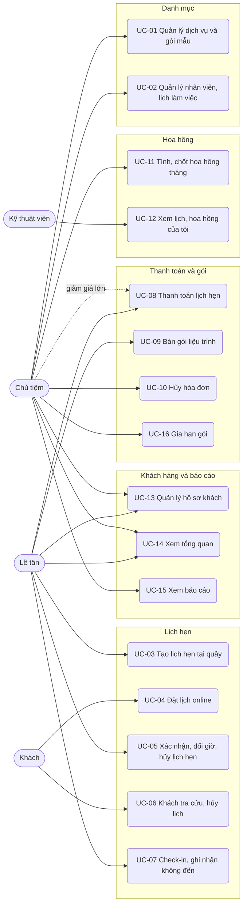
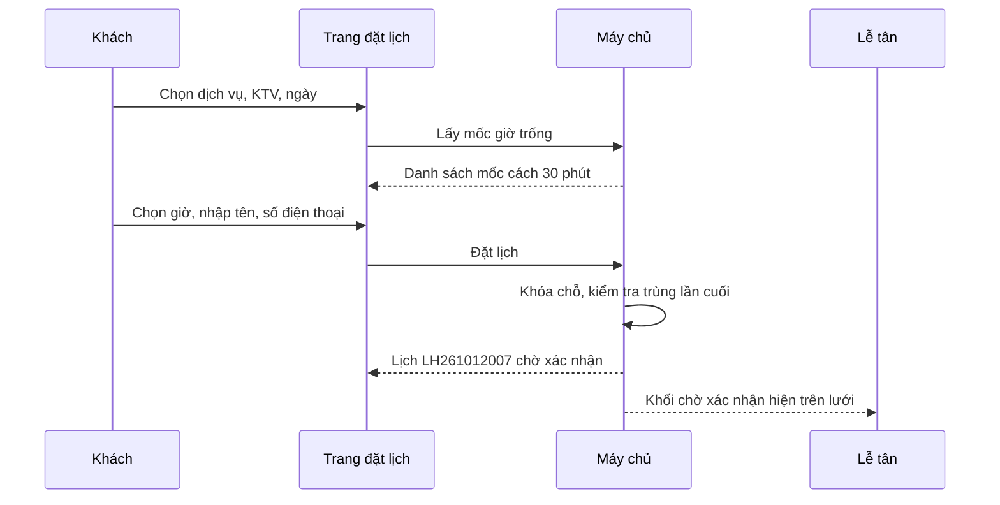

# Đặc tả use case — Quản lý Spa Salon

> Use case phần nền (UC-SYS-01 đến UC-SYS-10): `ZDOCS/03-KIEN-TRUC/USE-CASE-NEN.md`.
> Mã FR, BR, SCR tham chiếu `02-SRS.md`.

---

## 1. Tác nhân

| Tác nhân | Mã vai trò | Use case chính |
| :--- | :--- | :--- |
| Khách | — | UC-04, UC-06 |
| Lễ tân | `STAFF` | UC-03, UC-05, UC-07, UC-08, UC-09, UC-13, UC-14 |
| Kỹ thuật viên | `TECHNICIAN` | UC-12 |
| Chủ tiệm | `MANAGER` | UC-01, UC-02, UC-08 (giảm giá trên 10%), UC-10, UC-11, UC-13, UC-14, UC-15, UC-16 |
| Quản trị viên | `ADMIN` | Toàn bộ, cộng phần nền |

---

## 2. Sơ đồ use case

---

## 3. Danh sách use case

| Mã | Tên | Tác nhân chính | Module | Ưu tiên | FR |
| :--- | :--- | :--- | :--- | :---: | :--- |
| UC-01 | Quản lý dịch vụ và gói mẫu | Chủ tiệm | Danh mục | P1 | FR-03, FR-04 |
| UC-02 | Quản lý nhân viên, lịch làm việc | Chủ tiệm | Danh mục | P1 | FR-05, FR-06, FR-07 |
| UC-03 | Tạo lịch hẹn tại quầy | Lễ tân | Lịch hẹn | P1 | FR-08, FR-09, FR-10, FR-11, FR-35 |
| UC-04 | Đặt lịch online | Khách | Lịch hẹn | P1 | FR-18, FR-19, FR-20 |
| UC-05 | Xác nhận, đổi giờ, hủy lịch hẹn | Lễ tân | Lịch hẹn | P1 | FR-10, FR-12, FR-13, FR-14, FR-17 |
| UC-06 | Khách tra cứu, hủy lịch | Khách | Lịch hẹn | P2 | FR-21 |
| UC-07 | Check-in, ghi nhận không đến | Lễ tân | Lịch hẹn | P1 | FR-15, FR-16 |
| UC-08 | Thanh toán lịch hẹn | Lễ tân | Thanh toán và gói | P1 | FR-22, FR-23, FR-24, FR-25, FR-30 |
| UC-09 | Bán gói liệu trình | Lễ tân | Thanh toán và gói | P1 | FR-27, FR-28 |
| UC-10 | Hủy hóa đơn | Chủ tiệm | Thanh toán và gói | P2 | FR-26 |
| UC-11 | Tính, chốt hoa hồng tháng | Chủ tiệm | Hoa hồng | P1 | FR-30, FR-31, FR-32 |
| UC-12 | Xem lịch, hoa hồng của tôi | Kỹ thuật viên | Hoa hồng | P2 | FR-33 |
| UC-13 | Quản lý hồ sơ khách | Lễ tân, Chủ tiệm | Khách hàng và báo cáo | P2 | FR-34, FR-35 |
| UC-14 | Xem tổng quan | Chủ tiệm, Lễ tân | Khách hàng và báo cáo | P1 | FR-01, FR-02 |
| UC-15 | Xem báo cáo | Chủ tiệm | Khách hàng và báo cáo | P2 | FR-36, FR-37, FR-38 |
| UC-16 | Gia hạn gói | Chủ tiệm | Thanh toán và gói | P3 | FR-29 |

---

## 4. Đặc tả chi tiết

### UC-01: Quản lý dịch vụ và gói mẫu

| Mục | Nội dung |
| :--- | :--- |
| Tác nhân chính | Chủ tiệm |
| Mô tả | Thêm, sửa, ẩn dịch vụ, bảng giá, mức hoa hồng và gói liệu trình mẫu |
| Ưu tiên | P1 |
| Điều kiện kích hoạt | Tiệm thêm dịch vụ mới, đổi giá, ra gói ưu đãi |
| Tiền điều kiện | Có quyền `services.create`, `services.update` hoặc `packages.create`, `packages.update` |
| Hậu điều kiện | Lưới lịch hẹn, trang đặt online, hộp bán gói dùng thông tin mới ở lần tải kế tiếp |
| Yêu cầu liên quan | FR-03, FR-04, BR-02, BR-06, BR-14, BR-22, BR-23, BR-24, BR-27 |
| Màn hình | SCR-09, SCR-10 |

**Luồng chính (thêm dịch vụ)**

1. Chủ tiệm mở Dịch vụ; hệ thống hiển thị danh sách theo nhóm: mã, tên, thời lượng, giá, hoa hồng, số KTV làm được, trạng thái cho đặt online.
2. Chủ tiệm bấm "Thêm dịch vụ".
3. Nhập mã, tên, chọn nhóm, nhập thời lượng, thời gian dọn, giá, mô tả, tải ảnh.
4. Chọn kiểu hoa hồng (phần trăm giá hoặc số tiền cố định mỗi lượt) và nhập mức.
5. Bật "Cho đặt online" nếu muốn khách tự đặt dịch vụ này.
6. Bấm "Lưu"; hệ thống kiểm tra và lưu, dịch vụ xuất hiện trong danh sách.

**Luồng thay thế**

- 1a. Nhóm dịch vụ: tab Nhóm dịch vụ, thêm hoặc đổi tên, kéo thả sắp xếp, bật/tắt hiển thị.
- 1b. Thêm gói mẫu: mở Gói liệu trình, tab Gói mẫu, bấm "Thêm gói"; chọn dịch vụ, nhập số buổi, giá gói, hạn dùng, khoảng cách tối thiểu, tỉ lệ hoa hồng bán gói. Hệ thống hiện giá lẻ tương đương (giá dịch vụ × số buổi), số tiền và phần trăm tiết kiệm, giá trị một buổi (BR-22).
- 1c. Sửa giá dịch vụ: lịch hẹn đã tạo giữ giá cũ (BR-14).
- 1d. Ẩn dịch vụ hoặc ngừng bán gói mẫu: không còn ở hộp tạo lịch, trang đặt online, hộp bán gói; gói khách đã mua vẫn dùng bình thường.

**Luồng ngoại lệ**

- E1. Mã trùng: báo lỗi tại ô mã.
- E2. Thời lượng không phải bội số 15 phút, giá không phải bội số 1.000 ₫, hoa hồng phần trăm ngoài 0–50%: báo lỗi tại ô, không lưu.
- E3. Xóa dịch vụ hoặc gói mẫu đã có lịch hẹn, hóa đơn: hệ thống từ chối, gợi ý dùng "Ẩn" hoặc "Ngừng bán" (BR-27).
- E4. Bật cho đặt online nhưng chưa KTV nào làm được: vẫn lưu, hệ thống nhắc "Dịch vụ chưa hiện trên trang đặt lịch vì chưa có kỹ thuật viên" (BR-06).

### UC-02: Quản lý nhân viên, lịch làm việc

| Mục | Nội dung |
| :--- | :--- |
| Tác nhân chính | Chủ tiệm |
| Mô tả | Khai báo nhân viên, dịch vụ KTV làm được, ca làm theo tuần, ngày nghỉ, giờ mở cửa |
| Ưu tiên | P1 |
| Điều kiện kích hoạt | Có nhân viên mới, đổi lịch làm, KTV xin nghỉ |
| Tiền điều kiện | Có quyền `staff-members.create` hoặc `staff-members.update` |
| Hậu điều kiện | Lưới lịch hẹn và trang đặt online hiện đúng KTV, đúng ca |
| Yêu cầu liên quan | FR-05, FR-06, FR-07, BR-01, BR-04, BR-27 |
| Màn hình | SCR-11 |

**Luồng chính (thêm KTV và đặt lịch tuần)**

1. Chủ tiệm mở Nhân viên; hệ thống hiển thị danh sách: mã, họ tên, loại, số dịch vụ làm được, trạng thái.
2. Bấm "Thêm nhân viên", nhập mã, họ tên, số điện thoại, chọn loại "Kỹ thuật viên", chọn màu trên lịch, liên kết tài khoản nếu có.
3. Tick các dịch vụ KTV làm được.
4. Mở tab Lịch tuần, chọn ca cho từng thứ: Sáng, Chiều, Cả ngày hoặc Nghỉ.
5. Bấm "Lưu"; KTV xuất hiện thành cột trên lưới lịch hẹn ở các ngày có ca và trên trang đặt online.

**Luồng thay thế**

- 1a. Ngày nghỉ đột xuất: tab Ngày nghỉ, chọn KTV, ngày, nhập lý do, lưu.
- 1b. Giờ mở cửa: tab Giờ mở cửa, đổi giờ mở, giờ đóng, thêm ngày tiệm nghỉ (FR-07).
- 1c. Nghỉ việc: chuyển trạng thái "Nghỉ việc"; KTV không còn trên lưới và trang đặt online, dữ liệu cũ giữ nguyên.
- 2a. Thêm lễ tân: chọn loại "Lễ tân", bỏ qua bước 3–4; lễ tân có trong danh sách chọn người tư vấn khi bán gói.

**Luồng ngoại lệ**

- E1. Đổi ca, thêm ngày nghỉ hoặc bỏ dịch vụ làm được mà trùng lịch hẹn đã có: hệ thống liệt kê các lịch bị ảnh hưởng (ngày, giờ, khách, dịch vụ), không lưu cho tới khi các lịch đó được chuyển KTV hoặc hủy (BR-27).
- E2. Chuyển "Nghỉ việc" khi KTV còn lịch tương lai: từ chối, hiện số lịch còn lại.
- E3. Tài khoản đã liên kết với nhân viên khác: báo lỗi tại ô tài khoản.

### UC-03: Tạo lịch hẹn tại quầy

| Mục | Nội dung |
| :--- | :--- |
| Tác nhân chính | Lễ tân |
| Mô tả | Nhận lịch qua điện thoại, tin nhắn hoặc khách vãng lai, xếp KTV trên lưới không trùng |
| Ưu tiên | P1 |
| Điều kiện kích hoạt | Khách gọi điện, nhắn Zalo/Facebook hoặc tới tiệm |
| Tiền điều kiện | Có quyền `appointments.create` |
| Hậu điều kiện | Lịch hẹn "Đã xác nhận" có mã theo §5.3, khối hiện trên lưới |
| Yêu cầu liên quan | FR-08, FR-09, FR-10, FR-11, FR-35, BR-01 đến BR-05, BR-13, BR-14, BR-28 |
| Màn hình | SCR-02, SCR-03 |

**Luồng chính**

1. Lễ tân mở Lịch hẹn; hệ thống hiển thị lưới hôm nay, tự cuộn tới giờ hiện tại.
2. Lễ tân chọn ngày, chạm vào ô trống ở cột KTV và mốc giờ khách muốn; hệ thống mở hộp tạo lịch, điền sẵn KTV và giờ bắt đầu.
3. Nhập số điện thoại khách; hệ thống tìm hồ sơ, hiện tên, ghi chú da, gói đang có. Chưa có hồ sơ thì nhập tên để thêm nhanh.
4. Chọn dịch vụ; hệ thống tính giờ kết thúc theo BR-02, kiểm tra BR-01 đến BR-05 và hiện kết quả ngay dưới dòng.
5. Khách làm nhiều dịch vụ: bấm "Thêm dịch vụ"; dòng mới mặc định bắt đầu khi dòng trước kết thúc, lễ tân chọn KTV cho dòng đó.
6. Chọn nguồn, nhập ghi chú, bấm "Lưu".
7. Hệ thống tạo lịch hẹn "Đã xác nhận", ghi tin xác nhận (giả lập), khối hiện trên lưới.

**Luồng thay thế**

- 2a. Bấm "Tạo lịch hẹn" ở thanh trên, tự chọn ngày, KTV, giờ.
- 3a. Khách có gói còn buổi cho dịch vụ đã chọn: dòng hiện nhãn "Dùng gói, còn 6 buổi"; buổi được trừ khi thanh toán (UC-08).
- 3b. Khách có nhãn "Hay bỏ hẹn": hiện cảnh báo vàng kèm số lần không đến trong 90 ngày; lễ tân vẫn lưu được (BR-13).
- 4a. Bấm "Gợi ý": hệ thống hiện các KTV rảnh làm được dịch vụ tại giờ đã chọn và 3 giờ trống gần nhất của KTV đang chọn (FR-11).
- 5a. Hai dịch vụ làm cùng lúc: đặt cùng giờ bắt đầu cho hai KTV khác nhau (BR-05).

**Luồng ngoại lệ**

- E1. KTV bận: dòng báo đỏ "Nguyễn Thị Mai bận tới 15:10 (gồm thời gian dọn)", nút Lưu khóa (BR-03).
- E2. Ngoài ca của KTV, KTV nghỉ ngày đó hoặc ngoài giờ mở cửa: báo lý do cụ thể (BR-01, BR-04).
- E3. KTV không làm được dịch vụ: KTV đó không có trong danh sách chọn; nếu đã chạm ô của KTV đó thì báo "Không làm được dịch vụ này".
- E4. Khách đã có lịch khác chồng giờ: báo mã và giờ của lịch đó (BR-05).
- E5. Giờ bắt đầu sớm hơn mốc 15 phút hiện tại: không chọn được.
- E6. Số điện thoại sai định dạng: báo lỗi tại ô (BR-28).

### UC-04: Đặt lịch online

| Mục | Nội dung |
| :--- | :--- |
| Tác nhân chính | Khách |
| Mô tả | Khách tự chọn dịch vụ, KTV, giờ trống và đặt lịch trên điện thoại |
| Ưu tiên | P1 |
| Điều kiện kích hoạt | Khách bấm link đặt lịch trên fanpage, Google Maps, Zalo |
| Tiền điều kiện | Có ít nhất một dịch vụ hiện trên trang đặt online (BR-06) |
| Hậu điều kiện | Lịch hẹn "Chờ xác nhận" giữ chỗ trên lưới; hồ sơ khách được ghép hoặc tạo mới |
| Yêu cầu liên quan | FR-18, FR-19, FR-20, BR-01 đến BR-08, BR-28, NFR-03, NFR-04 |
| Màn hình | SCR-07 |

**Luồng chính**

1. Khách mở link; hệ thống hiện tên, logo tiệm và danh sách dịch vụ cho đặt online theo nhóm, mỗi dịch vụ có thời lượng và giá.
2. Bước 1: khách chọn 1–3 dịch vụ, bấm "Tiếp tục".
3. Bước 2: khách chọn KTV (ảnh, tên) hoặc "Bất kỳ ai"; chỉ hiện KTV làm được tất cả dịch vụ đã chọn.
4. Bước 3: khách chọn ngày trong 30 ngày tới; hệ thống hiện các mốc giờ còn trống, cách nhau 30 phút (BR-01 đến BR-07).
5. Bước 4: khách nhập họ tên, số điện thoại, ghi chú; xem tóm tắt gồm dịch vụ, KTV, giờ bắt đầu và kết thúc dự kiến, tổng tiền dự kiến; bấm "Đặt lịch".
6. Hệ thống kiểm tra lại chỗ trống, tạo lịch hẹn "Chờ xác nhận", ghép hoặc tạo hồ sơ khách theo số điện thoại (BR-28).
7. Hệ thống hiện màn đặt thành công: mã lịch hẹn, trạng thái, link tra cứu, dòng "Tiệm sẽ gọi hoặc nhắn xác nhận trong 30 phút".

**Luồng thay thế**

- 3a. Chọn "Bất kỳ ai": hệ thống gán KTV ở bước 6 theo BR-07; màn thành công hiện tên KTV được xếp.
- 4a. Ngày không còn mốc trống: hiện "Hết chỗ" và gợi ý ngày gần nhất còn trống.

**Luồng ngoại lệ**

- E1. Trong lúc khách nhập thông tin, giờ đó vừa có người đặt: báo "Giờ này vừa có người đặt, vui lòng chọn giờ khác", quay về bước 3 (NFR-04).
- E2. Số điện thoại đã có 2 lịch online chưa diễn ra: báo và gợi ý gọi hotline của tiệm (BR-06).
- E3. Số điện thoại sai định dạng: báo lỗi tại ô.

### UC-05: Xác nhận, đổi giờ, hủy lịch hẹn

| Mục | Nội dung |
| :--- | :--- |
| Tác nhân chính | Lễ tân |
| Mô tả | Xác nhận hoặc từ chối lịch online, kéo thả đổi giờ, đổi KTV, hủy lịch |
| Ưu tiên | P1 |
| Điều kiện kích hoạt | Có lịch online mới; khách xin đổi giờ hoặc hủy; KTV nghỉ đột xuất |
| Tiền điều kiện | Có quyền `appointments.update`; hủy cần `appointments.cancel` |
| Hậu điều kiện | Trạng thái và vị trí khối trên lưới được cập nhật; tin nhắn giả lập được ghi |
| Yêu cầu liên quan | FR-10, FR-12, FR-13, FR-14, FR-17, BR-03, BR-04, BR-05, BR-08, BR-09, BR-10, BR-13 |
| Màn hình | SCR-02, SCR-03, SCR-04 |

**Luồng chính (xác nhận lịch online)**

1. Lễ tân thấy khối "Chờ xác nhận" (viền nét đứt, nền vàng; chờ quá 30 phút thì nền cam) trên lưới hoặc trong danh sách ở Tổng quan.
2. Lễ tân mở lịch, xem thông tin khách (lịch sử, nhãn), dịch vụ, KTV, giờ.
3. Gọi hoặc nhắn khách nếu cần, bấm "Xác nhận".
4. Hệ thống chuyển lịch sang "Đã xác nhận", ghi tin xác nhận (giả lập).

**Luồng thay thế**

- 3a. Từ chối: chọn lý do (Hết chỗ, Không liên lạc được, Khác kèm ghi chú); lịch chuyển "Đã hủy", ghi tin hủy.
- 3b. Đổi KTV hoặc giờ trước khi xác nhận: sửa trong hộp lịch hẹn, hệ thống kiểm tra như UC-03, rồi xác nhận.
- 1a. Đổi giờ bằng kéo thả: lễ tân giữ khối, kéo sang mốc khác hoặc cột KTV khác, thả; hệ thống kiểm tra BR-09, lưu và ghi tin đổi lịch.
- 1b. Hủy lịch: mở lịch, bấm "Hủy lịch", chọn lý do (Khách báo hủy, Tiệm đổi lịch, Khác kèm ghi chú); lịch rời khỏi lưới, chỗ trống trở lại.

**Luồng ngoại lệ**

- E1. Kéo thả vi phạm trùng lịch, ngoài ca, KTV không làm được dịch vụ: khối trở về chỗ cũ, hiện lý do.
- E2. Kéo khối thuộc lịch "Hoàn thành", "Đã hủy", "Không đến" hoặc dòng đã tới giờ bắt đầu của lịch "Đang phục vụ": không kéo được.
- E3. Hủy mà chưa chọn lý do: nút "Xác nhận hủy" khóa.

### UC-06: Khách tra cứu, hủy lịch

| Mục | Nội dung |
| :--- | :--- |
| Tác nhân chính | Khách |
| Mô tả | Khách xem lại lịch đã đặt và tự hủy khi còn đủ thời gian |
| Ưu tiên | P2 |
| Yêu cầu liên quan | FR-21, BR-10, NFR-05 |
| Màn hình | SCR-08 |

**Luồng chính**

1. Khách mở link tra cứu (trong màn đặt thành công hoặc tin nhắn), nhập mã lịch hẹn và số điện thoại.
2. Hệ thống hiện lịch: dịch vụ, KTV, giờ, trạng thái, số điện thoại đã che.
3. Giờ bắt đầu còn cách ít nhất 2 giờ: khách bấm "Hủy lịch", chọn lý do, xác nhận; lịch chuyển "Đã hủy", ghi tin hủy.
4. Dưới 2 giờ: nút hủy ẩn, trang hiện "Vui lòng gọi tiệm" kèm số hotline.

### UC-07: Check-in, ghi nhận không đến

| Mục | Nội dung |
| :--- | :--- |
| Tác nhân chính | Lễ tân |
| Mô tả | Ghi nhận khách tới, thêm hoặc bỏ dịch vụ khi đang phục vụ, ghi nhận khách không tới |
| Ưu tiên | P1 |
| Điều kiện kích hoạt | Khách tới quầy; hoặc quá giờ hẹn mà khách chưa tới |
| Tiền điều kiện | Có quyền `appointments.update`; lịch thuộc hôm nay |
| Hậu điều kiện | Lịch "Đang phục vụ" có giờ check-in; hoặc lịch "Không đến", chỗ KTV được giải phóng |
| Yêu cầu liên quan | FR-15, FR-16, BR-11, BR-12, BR-13, BR-14 |
| Màn hình | SCR-02, SCR-04 |

**Luồng chính**

1. Khách tới quầy; lễ tân tìm lịch trên lưới hoặc theo số điện thoại.
2. Lễ tân bấm "Check-in"; hệ thống ghi giờ check-in, chuyển lịch sang "Đang phục vụ", khối đổi màu xanh lá.
3. KTV đón khách vào làm dịch vụ.
4. Khách muốn làm thêm: lễ tân bấm "Thêm dịch vụ", chọn dịch vụ, KTV, giờ (mặc định nối tiếp dòng cuối); hệ thống kiểm tra như UC-03 và lấy giá hiện hành (BR-14).

**Luồng thay thế**

- 2a. Lịch đang "Chờ xác nhận": check-in đồng thời xác nhận (BR-11).
- 4a. Khách bỏ một dịch vụ chưa làm: lễ tân xóa dòng; dòng bị bỏ không tính tiền, không tính hoa hồng.
- 1a. Khách không tới: quá giờ bắt đầu 15 phút, khối hiện nhãn "Trễ"; lễ tân gọi khách, khách không tới thì bấm "Không đến"; chỗ KTV trống lại, số lần không đến của khách tăng 1 (BR-12, BR-13).
- 1b. 23:59: hệ thống tự chuyển các lịch chưa check-in trong ngày sang "Không đến".

**Luồng ngoại lệ**

- E1. Lịch không thuộc hôm nay: không có nút "Check-in" (BR-11).
- E2. Chưa quá giờ bắt đầu 15 phút: không có nút "Không đến" (BR-12).

### UC-08: Thanh toán lịch hẹn

| Mục | Nội dung |
| :--- | :--- |
| Tác nhân chính | Lễ tân |
| Tác nhân phụ | Chủ tiệm (giảm giá trên 10%) |
| Mô tả | Trừ buổi gói, giảm giá, thu tiền, tạo hóa đơn, ghi hoa hồng, in hóa đơn |
| Ưu tiên | P1 |
| Điều kiện kích hoạt | Khách làm xong dịch vụ, ra quầy |
| Tiền điều kiện | Lịch "Đang phục vụ"; có quyền `invoices.create` |
| Hậu điều kiện | Hóa đơn "Đã thanh toán" có mã theo §5.3; lịch "Hoàn thành"; gói bị trừ buổi; hoa hồng được ghi |
| Yêu cầu liên quan | FR-22, FR-23, FR-24, FR-25, FR-30, BR-15 đến BR-19, BR-22, BR-23 |
| Màn hình | SCR-04, SCR-05, SCR-06 |

**Luồng chính**

1. Lễ tân mở lịch "Đang phục vụ", bấm "Thanh toán".
2. Hệ thống mở hộp thanh toán: các dòng dịch vụ với KTV và giá; dòng có gói hợp lệ tự bật "Trừ buổi", kèm mã gói và số buổi còn lại sau khi trừ (BR-18).
3. Lễ tân đọc lại với khách, tắt "Trừ buổi" ở dòng khách muốn trả lẻ.
4. Nhập giảm giá nếu có: chọn phần trăm hoặc số tiền, chọn lý do (BR-16).
5. Hệ thống hiện tổng tiền theo BR-15.
6. Lễ tân chọn phương thức: tiền mặt (nút mệnh giá nhanh hoặc nhập tiền khách đưa, hiện tiền thối), chuyển khoản (QR giả lập, bấm "Đã nhận tiền") hoặc thẻ (nhập mã chuẩn chi).
7. Bấm "Hoàn tất"; hệ thống tạo hóa đơn, trừ buổi gói, ghi hoa hồng (BR-23), chuyển lịch sang "Hoàn thành", mở bản in.
8. Bản in khổ 80 mm gồm thông tin tiệm, mã hóa đơn, ngày giờ, khách, từng dịch vụ với KTV và giá, dòng trừ buổi ghi "Trừ gói GL…, còn N buổi, hạn dd/MM/yyyy", giảm giá, tổng tiền, phương thức, tiền khách đưa, tiền thối.

**Luồng thay thế**

- 2a. Khách mua gói ngay lúc thanh toán: xem UC-09 luồng 1a.
- 3a. Dòng trừ buổi chưa đủ khoảng cách tối thiểu: hệ thống cảnh báo "Buổi gần nhất cách 3 ngày, gói yêu cầu 7 ngày", lễ tân nhập lý do mới tiếp tục được (BR-19).
- 4a. Giảm trên 10%: chủ tiệm đăng nhập (hoặc đổi vai trò) và nhập giảm giá, tối đa 50% tiền dịch vụ lẻ.
- 5a. Tổng 0 ₫ vì mọi dòng trừ buổi: bỏ qua bước 6 (BR-15).

**Luồng ngoại lệ**

- E1. Tiền khách đưa nhỏ hơn tổng: nút "Hoàn tất" khóa, hiện số tiền còn thiếu (BR-17).
- E2. Giảm vượt hạn mức của vai trò: báo "Lễ tân giảm tối đa 10% (70.000 ₫)", không áp.
- E3. Gói hết hạn hoặc hết buổi: dòng không bật "Trừ buổi", hiện ghi chú "Gói GL… hết hạn ngày dd/MM/yyyy".
- E4. Mất kết nối khi bấm "Hoàn tất" (chế độ `api`): hộp thanh toán giữ nguyên, báo thử lại; bấm lại không tạo trùng hóa đơn, không trừ buổi hai lần.

### UC-09: Bán gói liệu trình

| Mục | Nội dung |
| :--- | :--- |
| Tác nhân chính | Lễ tân |
| Mô tả | Bán gói cho khách, riêng hoặc kèm hóa đơn lịch hẹn; theo dõi gói của khách |
| Ưu tiên | P1 |
| Điều kiện kích hoạt | Khách đồng ý mua gói sau khi được tư vấn |
| Tiền điều kiện | Có quyền `customer-packages.sell`; có gói mẫu đang bán |
| Hậu điều kiện | Gói của khách "Đang dùng" có mã theo §5.3; hóa đơn được tạo; hoa hồng bán gói ghi cho người tư vấn |
| Yêu cầu liên quan | FR-27, FR-28, BR-17, BR-20, BR-21, BR-24 |
| Màn hình | SCR-10, SCR-05, SCR-06 |

**Luồng chính (bán riêng)**

1. Lễ tân mở Gói liệu trình, tab Gói của khách, bấm "Bán gói".
2. Chọn khách theo số điện thoại (hoặc thêm nhanh), chọn gói mẫu đang bán; hệ thống hiện số buổi, giá, hạn dùng dự kiến (BR-20), số tiền tiết kiệm so với giá lẻ.
3. Chọn người tư vấn (KTV hoặc lễ tân).
4. Chọn phương thức và thu tiền như UC-08 bước 6.
5. Bấm "Hoàn tất"; hệ thống tạo hóa đơn, tạo gói của khách "Đang dùng", ghi hoa hồng bán gói (BR-24), mở bản in.

**Luồng thay thế**

- 1a. Bán kèm khi thanh toán lịch hẹn: trong hộp thanh toán bấm "Bán gói kèm", chọn gói, người tư vấn; lịch có dòng cùng dịch vụ thì hệ thống bật "Trừ buổi" bằng gói vừa bán (BR-21); tổng tiền cộng giá gói.
- 1b. Theo dõi gói: lọc Đang dùng, Sắp hết hạn (30 ngày), Còn 1 buổi, Hết hạn; mở một gói để xem lịch sử trừ buổi.

**Luồng ngoại lệ**

- E1. Chưa chọn khách hoặc người tư vấn: báo lỗi tại ô, không tạo gói.
- E2. Gói mẫu đã ngừng bán: không có trong danh sách chọn.

### UC-10: Hủy hóa đơn

| Mục | Nội dung |
| :--- | :--- |
| Tác nhân chính | Chủ tiệm |
| Mô tả | Hủy hóa đơn thu nhầm, trả lại buổi gói và hoa hồng |
| Ưu tiên | P2 |
| Yêu cầu liên quan | FR-26, BR-25, BR-26 |
| Màn hình | SCR-04, SCR-10 |

**Luồng chính**

1. Chủ tiệm mở chi tiết lịch hẹn đã hoàn thành (hoặc gói của khách với hóa đơn bán riêng), bấm "Hủy hóa đơn".
2. Nhập lý do, xác nhận.
3. Hệ thống chuyển hóa đơn sang "Đã hủy", trả lại buổi đã trừ, xóa hoa hồng của hóa đơn, đưa lịch hẹn về "Đang phục vụ" để lễ tân thanh toán lại.
4. Hóa đơn thuộc tháng đã chốt hoa hồng: nút "Hủy hóa đơn" vô hiệu, có chú thích lý do.

### UC-11: Tính, chốt hoa hồng tháng

| Mục | Nội dung |
| :--- | :--- |
| Tác nhân chính | Chủ tiệm |
| Mô tả | Xem hoa hồng từng nhân viên trong tháng, kiểm tra chi tiết, chốt để trả lương |
| Ưu tiên | P1 |
| Điều kiện kích hoạt | Giữa tháng xem tạm tính; đầu tháng sau chốt để trả lương |
| Tiền điều kiện | Có quyền `commissions.view`; chốt cần `commissions.close` |
| Hậu điều kiện | Bảng tháng "Đã chốt", hoa hồng không đổi nữa |
| Yêu cầu liên quan | FR-30, FR-31, FR-32, BR-22 đến BR-26 |
| Màn hình | SCR-12 |

**Luồng chính**

1. Chủ tiệm mở Hoa hồng; mặc định tháng hiện tại, trạng thái "Tạm tính".
2. Hệ thống hiển thị bảng: mỗi nhân viên một dòng gồm số lượt dịch vụ, doanh số tính hoa hồng (tổng giá căn cứ), hoa hồng dịch vụ, số gói bán, hoa hồng bán gói, tổng; dòng cuối là tổng cộng.
3. Chủ tiệm bấm một dòng; hệ thống hiện chi tiết từng khoản: ngày, mã hóa đơn, khách, dịch vụ hoặc gói, giá căn cứ, kiểu, mức, số tiền.
4. Từ ngày 01 tháng sau, chủ tiệm chọn tháng trước, kiểm tra, bấm "Chốt bảng hoa hồng", xác nhận.
5. Hệ thống chuyển bảng sang "Đã chốt", ghi người chốt và ngày chốt; các hóa đơn của tháng đó không hủy được nữa.

**Luồng thay thế**

- 1a. Đổi tháng để xem bảng cũ.
- 5a. Sau khi trả tiền cho nhân viên: bấm "Đánh dấu đã chi trả" (FR-32).

**Luồng ngoại lệ**

- E1. Chốt tháng chưa kết thúc: nút "Chốt bảng hoa hồng" khóa, chú thích "Chỉ chốt từ 01/11/2026" (BR-25).
- E2. Tháng chưa có hoa hồng: bảng hiển thị trạng thái trống.

### UC-12: Xem lịch, hoa hồng của tôi

| Mục | Nội dung |
| :--- | :--- |
| Tác nhân chính | Kỹ thuật viên |
| Mô tả | KTV xem trên điện thoại hôm nay làm cho ai, lúc nào và hoa hồng tạm tính |
| Ưu tiên | P2 |
| Yêu cầu liên quan | FR-33, NFR-06 |
| Màn hình | SCR-13 |

**Luồng chính**

1. KTV đăng nhập trên điện thoại; hệ thống mở thẳng Lịch của tôi, ngày hôm nay.
2. Danh sách theo giờ: giờ bắt đầu và kết thúc, tên khách, dịch vụ, trạng thái, ghi chú da và dị ứng của khách; số điện thoại khách không hiển thị.
3. KTV vuốt sang ngày khác để xem lịch các ngày tới.
4. Tab Hoa hồng: tổng hoa hồng tạm tính tháng này và danh sách từng khoản của chính KTV.

### UC-13: Quản lý hồ sơ khách

| Mục | Nội dung |
| :--- | :--- |
| Tác nhân chính | Lễ tân, Chủ tiệm |
| Mô tả | Tra cứu, cập nhật hồ sơ khách, xem lịch sử và gói |
| Ưu tiên | P2 |
| Yêu cầu liên quan | FR-34, FR-35, BR-13, BR-28 |
| Màn hình | SCR-14 |

**Luồng chính**

1. Lễ tân mở Khách hàng, tìm theo số điện thoại hoặc tên; lọc theo nhãn "Hay bỏ hẹn", khách có gói đang dùng.
2. Mở một khách; hệ thống hiện thông tin, ghi chú da và dị ứng, tổng chi tiêu, số lần không đến trong 90 ngày, nhãn.
3. Tab Lịch hẹn: mọi lịch kể cả đã hủy, không đến; tab Gói: các gói và số buổi còn lại; tab Hóa đơn.
4. Lễ tân sửa ghi chú (vd "Da nhạy cảm, dị ứng AHA"), lưu.

### UC-14: Xem tổng quan

| Mục | Nội dung |
| :--- | :--- |
| Tác nhân chính | Chủ tiệm, Lễ tân |
| Mô tả | Nắm nhanh tình hình lịch hẹn và thực thu hôm nay |
| Ưu tiên | P1 |
| Tiền điều kiện | Có quyền `dashboard.view` |
| Hậu điều kiện | Không thay đổi dữ liệu |
| Yêu cầu liên quan | FR-01, FR-02, BR-08, BR-29 |
| Màn hình | SCR-01 |

**Luồng chính**

1. Chủ tiệm hoặc lễ tân đăng nhập; hệ thống mở Tổng quan.
2. Hiển thị các thẻ số: tổng lịch hôm nay, chờ xác nhận, đang phục vụ, hoàn thành, không đến; thực thu hôm nay; khách mới hôm nay.
3. Hiển thị danh sách lịch bắt đầu trong 2 giờ tới (giờ, khách, dịch vụ, KTV, trạng thái) và danh sách lịch online chờ xác nhận, lịch chờ quá 30 phút tô cam.
4. Bấm một dòng: mở chi tiết lịch hẹn.

**Luồng thay thế**

- 2a. Bấm thẻ "Chờ xác nhận": chuyển tới Lịch hẹn, lọc sẵn các lịch chờ xác nhận.

**Luồng ngoại lệ**

- E1. Hôm nay là ngày tiệm nghỉ: hiện "Hôm nay tiệm nghỉ" và danh sách lịch ngày mai.
- E2. Kỹ thuật viên mở `/dashboard`: chuyển tới `/forbidden`.

### UC-15: Xem báo cáo

| Mục | Nội dung |
| :--- | :--- |
| Tác nhân chính | Chủ tiệm |
| Mô tả | Phân tích thực thu, giá trị dịch vụ đã làm, dịch vụ, KTV, gói |
| Ưu tiên | P2 |
| Yêu cầu liên quan | FR-36, FR-37, FR-38, BR-22, BR-29 |
| Màn hình | SCR-15 |

**Luồng chính**

1. Chủ tiệm mở Báo cáo; mặc định tab Doanh thu, khoảng 30 ngày gần nhất.
2. Hệ thống hiển thị biểu đồ cột chồng thực thu (dịch vụ lẻ, bán gói) theo ngày, đường giá trị dịch vụ đã làm, bảng số liệu và so sánh kỳ trước.
3. Chủ tiệm đổi khoảng ngày (Hôm nay, 7 ngày, 30 ngày, Tháng này, Tháng trước, Tùy chọn tối đa 366 ngày).
4. Chuyển tab Dịch vụ, Kỹ thuật viên, Gói liệu trình, Hủy và không đến để xem các báo cáo khác.
