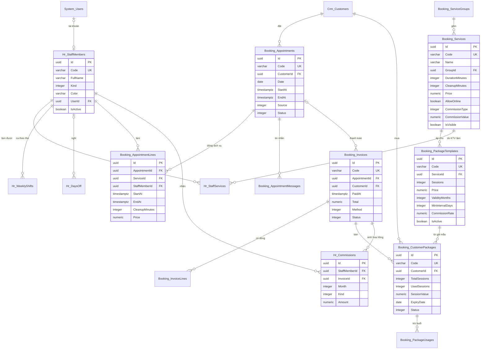

# Thiết kế CSDL — Quản lý Spa Salon

> Database: `WebDemo_ServiceSpaSalon` (Postgres; SQLite, SQL Server khi cần).
> Quy ước chung và nhóm bảng nền `System_*` (tài khoản, vai trò, quyền, cài đặt, nhật ký): xem `ZDOCS/03-KIEN-TRUC/THIET-KE-CSDL-NEN.md`.
> File này chỉ mô tả **bảng nghiệp vụ riêng của dự án**. Area: `Booking` (dịch vụ, gói, lịch hẹn, hóa đơn, gói của khách), `Hr` (nhân viên, lịch làm việc, ngày nghỉ, hoa hồng), `Crm` (khách hàng).
> Mã FR, BR, TC tham chiếu `02-SRS.md` và `05-KICH-BAN-KIEM-THU.md`. Hợp đồng API, công thức tính: `07-DANH-SACH-API.md`.

---

## 1. Sơ đồ

---

## 2. Danh sách bảng

| Bảng | Area | Mô tả | Dữ liệu mẫu |
| :--- | :--- | :--- | :---: |
| `Booking_ServiceGroups` | Booking | Nhóm dịch vụ | 6 |
| `Booking_Services` | Booking | Dịch vụ, bảng giá, mức hoa hồng | 30 |
| `Booking_PackageTemplates` | Booking | Gói liệu trình mẫu | 8 |
| `Booking_BusinessHours` | Booking | Giờ mở, đóng cửa (một dòng) | 1 |
| `Booking_Appointments` | Booking | Lịch hẹn | ~1.200 |
| `Booking_AppointmentLines` | Booking | Dòng dịch vụ của lịch hẹn | ~1.500 |
| `Booking_AppointmentMessages` | Booking | Nhật ký tin nhắn giả lập (FR-17) | theo lịch tương lai |
| `Booking_Invoices` | Booking | Hóa đơn | ~1.000 |
| `Booking_InvoiceLines` | Booking | Dòng hóa đơn: dịch vụ hoặc gói bán | ~1.300 |
| `Booking_CustomerPackages` | Booking | Gói khách đã mua | ~45 |
| `Booking_PackageUsages` | Booking | Lần trừ buổi | ~180 |
| `Hr_StaffMembers` | Hr | Nhân viên: KTV, lễ tân | 8 |
| `Hr_StaffServices` | Hr | Dịch vụ KTV làm được | ~45 |
| `Hr_WeeklyShifts` | Hr | Ca làm theo thứ của KTV | 42 |
| `Hr_DaysOff` | Hr | Ngày nghỉ đột xuất của KTV hoặc ngày tiệm nghỉ | 4 |
| `Hr_Commissions` | Hr | Khoản hoa hồng | ~1.300 |
| `Hr_CommissionPeriods` | Hr | Bảng hoa hồng tháng | 4–5 |
| `Crm_Customers` | Crm | Hồ sơ khách | 200 |

Số đúng của mỗi lần nạp phụ thuộc thứ trong tuần của ngày nạp (§5.3); script in số tham chiếu ở §5.7.

---

## 3. Quy ước chung của dự án

- Mọi bảng có cột chung `Id`, `CreatedAt`, `CreatedBy`, `UpdatedAt`, `UpdatedBy` theo `THIET-KE-CSDL-NEN.md` §1. Không bảng nào xóa mềm: danh mục đã phát sinh dữ liệu thì chỉ ẩn hoặc ngừng (BR-27), chưa phát sinh thì xóa cứng.
- **Tiền** `numeric(18,2)`, luôn là số nguyên đồng; giá, giá gói, mức hoa hồng cố định là bội số 1.000 ₫. Mọi phép làm tròn trong `07` §3 làm tròn **xuống** tới bội số 1.000 ₫.
- **Thời gian** lưu UTC. Ngày của lịch hẹn, ngày nghỉ, hạn dùng gói, tháng hoa hồng, mã chứng từ, bộ lọc ngày, báo cáo tính theo **giờ Việt Nam** (`VietnamDates`, FE `vn-time.ts`). Cột ngày thuần dùng `date` (`DateOnly`). Giờ trong ngày (giờ mở cửa) lưu số phút từ 00:00 (`integer`).
- **Enum** lưu `integer`, API trả chuỗi PascalCase không dấu (cùng tên enum C#, bảng tra ở `07` §2).
- **Chụp dữ liệu** (BR-14, §5.1 SRS): dòng dịch vụ lưu tên, giá, thời lượng, thời gian dọn lúc tạo; gói của khách lưu số buổi, giá, giá trị một buổi, khoảng cách tối thiểu, hạn dùng lúc mua; hóa đơn, hoa hồng lưu tên KTV, tên khách, mã hóa đơn. Đổi danh mục sau đó không làm đổi dữ liệu cũ. Người thao tác chụp họ tên vào cột `…ByName`.
- **Một cổng ghi** (NFR-04): mọi thao tác tạo, đổi giờ, đổi KTV, check-in, thêm dòng lịch hẹn, thanh toán, bán gói, hủy hóa đơn chạy tuần tự qua `BookingGate` (một `SemaphoreSlim` trong tiến trình) rồi mới kiểm tra trùng lịch và lưu, trong một transaction. Demo chạy một tiến trình BE nên hai người đặt cùng mốc chỉ một người lưu được. Index `(StaffMemberId, StartAt)` của dòng dịch vụ để kiểm tra trùng nhanh.
- **Chống bấm lặp** (UC-08 E4): `Booking_Invoices.ClientRequestId varchar(64)` unique (cho phép null). Gửi lại cùng mã trả hóa đơn đã tạo, không trừ buổi lần hai.
- **Mã chứng từ** (BR-30, SRS §5.3) sinh trong `BookingGate`: `LH`, `HD`, `GL` + `yyMMdd` (ngày tạo chứng từ, giờ Việt Nam) + 3 số, đếm lại từ 001 mỗi ngày, mỗi tiền tố một dãy (số tiếp theo = số lớn nhất trong ngày + 1). `HH` + `yyMM` cho bảng hoa hồng. Danh mục: `DV` + 3 số, `GOI` + 2 số, `NV` + 2 số do người dùng nhập (gợi ý mã kế tiếp); khách `KH` + 5 số tự sinh.
- **Nhật ký thao tác**: nhóm dịch vụ, dịch vụ, gói mẫu, nhân viên, ca tuần, ngày nghỉ, giờ mở cửa, khách hàng ghi `System_AuditLogs` như nền. Lịch hẹn, dòng, tin nhắn, hóa đơn, dòng hóa đơn, gói của khách, lần trừ buổi, hoa hồng, bảng hoa hồng đánh dấu `IAuditLogExempt` (ghi nhiều, bản ghi đã tự lưu người và giờ thao tác).
- **Việc nền** (`Infrastructure/BackgroundJobs/BookingMaintenanceJob`, chạy lúc khởi động rồi mỗi 5 phút; FE mock chạy cùng việc này khi đọc dữ liệu):
  1. BR-12: lịch `ChoXacNhan`, `DaXacNhan` của **ngày trước hôm nay** chuyển `KhongDen` (tương đương mốc 23:59, kể cả khi máy chủ tắt lúc đó).
  2. BR-20: gói `DangDung` có `ExpiryDate < hôm nay` và còn buổi chuyển `HetHan`.
  3. FR-17 (P3): lịch `DaXacNhan` bắt đầu trong 2 giờ tới chưa có tin nhắc thì ghi tin nhắc.
- Đặt lại dữ liệu demo xóa cứng toàn bộ bảng `Booking_*`, `Hr_*`, `Crm_*` (bảng con trước) rồi nạp lại.
- Cài đặt dùng chung lưu ở `System_Settings` (giá trị mẫu trong `FE/src/mock/seed/project.json`, nhãn ở `FE/src/config/setting-labels.ts`):

| Khóa | Nhóm | Giá trị mẫu | Ghi chú |
| :--- | :--- | :--- | :--- |
| `Brand.AppName` | Thương hiệu | `Lam Ngọc Spa` | |
| `Brand.LogoUrl` | Thương hiệu | `/logo/logo-mark.svg` | |
| `Brand.PrimaryColor` | Thương hiệu | `#0F766E` | Xanh ngọc đậm, chữ trắng tương phản 5,5:1 |
| `Store.Name` | Thông tin tiệm | `Lam Ngọc Spa & Nail` | In đầu hóa đơn, trang đặt lịch |
| `Store.Address` | Thông tin tiệm | `86 Lê Đình Dương, Hải Châu, Đà Nẵng` | |
| `Store.Hotline` | Thông tin tiệm | `0905 286 168` | Trang tra cứu khi không tự hủy được (BR-10) |
| `Store.BankBin` | Thông tin tiệm | `970436` | Mã ngân hàng của QR giả lập |
| `Store.BankAccount` | Thông tin tiệm | `0000000000` | Số tài khoản giả, QR không chuyển được tiền thật |
| `Store.BankAccountName` | Thông tin tiệm | `LAM NGOC SPA` | |

Kiểm tra khi lưu (FE `validateProjectSettings`, BE `UpdateSettingsRequestValidator`): `Store.Name` bắt buộc; `Store.BankBin` 6 chữ số; `Store.BankAccount` 6 đến 19 chữ số. Người đăng nhập nào cũng đọc được nhóm này qua `GET /api/store-profile` (bản in hóa đơn, QR).

Hằng số nghiệp vụ là hằng trong code, BE `BookingRules` và FE `features/booking/lib/rules.ts` cùng giá trị: bước giờ 15 phút; mốc đặt online cách 30 phút; đặt online trước ít nhất 120 phút, trong 30 ngày, tối đa 3 dịch vụ, tối đa 2 lịch chờ theo số điện thoại; lịch hẹn tối đa 5 dòng; chờ xác nhận quá 30 phút tô cam; "Không đến" sau 15 phút; khách tự hủy trước ít nhất 120 phút; nhãn "Hay bỏ hẹn" từ 3 lần trong 90 ngày; lễ tân giảm tối đa 10%, chủ tiệm 50%; gia hạn tối đa 60 ngày; ca sáng kết thúc, ca chiều bắt đầu lúc 15:00; khoảng ngày báo cáo tối đa 366 ngày.

---

## 4. Mô tả bảng

### `Booking_ServiceGroups`: nhóm dịch vụ

| Cột | Kiểu | Ràng buộc | Ghi chú |
| :--- | :--- | :--- | :--- |
| `Name` | `varchar(100)` | bắt buộc, unique | `Chăm sóc da` |
| `SortOrder` | `integer` | | Thứ tự trên lưới, hộp tạo lịch, trang đặt online; kéo thả đổi thứ tự (UC-01 1a) |
| `IsVisible` | `boolean` | mặc định 1 | Nhóm ẩn: dịch vụ trong nhóm không hiện ở trang đặt online, hộp tạo lịch |

Xóa nhóm chỉ khi nhóm không còn dịch vụ.

### `Booking_Services`: dịch vụ

| Cột | Kiểu | Ràng buộc | Ghi chú |
| :--- | :--- | :--- | :--- |
| `Code` | `varchar(10)` | unique, `^[A-Z0-9]{2,10}$` | `DV001`; trùng → 409 (UC-01 E1) |
| `Name` | `varchar(150)` | bắt buộc | |
| `GroupId` | `uuid` | FK `Booking_ServiceGroups` | |
| `DurationMinutes` | `integer` | 15–240, bội số 15 (BR-02) | |
| `CleanupMinutes` | `integer` | 0–30, bội số 5, mặc định 10 (BR-02) | |
| `Price` | `numeric(18,2)` | ≥ 0, bội số 1.000 | |
| `Description` | `varchar(1000)` | | Hiện ở trang đặt online |
| `ImageUrl` | `varchar(500)` | | `/seed/services/{kiểu}.webp` hoặc ảnh tải lên |
| `AllowOnline` | `boolean` | | "Cho đặt online" (BR-06) |
| `CommissionType` | `integer` | enum | `PhanTram`, `CoDinh` |
| `CommissionValue` | `numeric(18,2)` | phần trăm 0–50; cố định ≥ 0, bội số 1.000 | BR-23 |
| `IsVisible` | `boolean` | mặc định 1 | Ẩn: không còn ở hộp tạo lịch, trang đặt online (UC-01 1d) |

Xóa chỉ khi chưa có dòng lịch hẹn, gói mẫu, dòng hóa đơn (BR-27, UC-01 E3); xóa kèm `Hr_StaffServices`.

### `Booking_PackageTemplates`: gói mẫu

| Cột | Kiểu | Ràng buộc | Ghi chú |
| :--- | :--- | :--- | :--- |
| `Code` | `varchar(10)` | unique | `GOI01` |
| `Name` | `varchar(150)` | bắt buộc | `Chăm sóc da cơ bản 10 buổi` |
| `ServiceId` | `uuid` | FK `Booking_Services` | Mỗi gói áp cho đúng một dịch vụ |
| `Sessions` | `integer` | 2–50 | |
| `Price` | `numeric(18,2)` | > 0, bội số 1.000 | |
| `ValidityMonths` | `integer` | 1–36 | BR-20 |
| `MinIntervalDays` | `integer` | 0–90 | 0 = không giới hạn (BR-19) |
| `CommissionRate` | `numeric(5,2)` | 0–50, mặc định 5 | BR-24 |
| `IsActive` | `boolean` | | "Đang bán"; ngừng bán thì không có trong hộp bán gói (UC-09 E2) |

Xóa chỉ khi chưa có gói của khách (BR-27).

### `Booking_BusinessHours`: giờ mở cửa

Một dòng duy nhất. `OpenMinute integer` (mặc định 540 = 09:00), `CloseMinute integer` (mặc định 1260 = 21:00). Bội số 15, `OpenMinute < CloseMinute ≤ 1380`, mở tối thiểu 4 giờ. Đổi giờ mà lịch tương lai rơi ra ngoài giờ mới thì liệt kê lịch bị ảnh hưởng, không lưu (cùng cách BR-27).

### `Hr_StaffMembers`: nhân viên

| Cột | Kiểu | Ràng buộc | Ghi chú |
| :--- | :--- | :--- | :--- |
| `Code` | `varchar(10)` | unique, `^[A-Z0-9]{2,10}$` | `NV01` |
| `FullName` | `varchar(100)` | bắt buộc | |
| `Phone` | `varchar(10)` | 10 chữ số, bắt đầu bằng 0 | |
| `Kind` | `integer` | enum | `KyThuatVien`, `LeTan` |
| `Color` | `varchar(7)` | `#RRGGBB` | Màu cột, viền khối trên lưới |
| `Specialty` | `varchar(150)` | | Dòng mô tả dưới tên ở trang đặt online, vd "Chăm sóc da, massage" |
| `UserId` | `uuid` | FK `System_Users`, unique khi khác null | Tối đa một tài khoản; KTV có tài khoản vai trò `TECHNICIAN` xem được lịch của mình (UC-02 E3) |
| `IsActive` | `boolean` | | Đang làm / Nghỉ việc; KTV còn lịch tương lai không chuyển Nghỉ việc được (BR-27, UC-02 E2) |
| `SortOrder` | `integer` | | Thứ tự cột trên lưới; mặc định theo mã |

Xóa chỉ khi chưa có dòng lịch hẹn, hoa hồng, gói bán (người tư vấn).

### `Hr_StaffServices`: dịch vụ KTV làm được

`StaffMemberId` FK (cascade), `ServiceId` FK (cascade); unique `(StaffMemberId, ServiceId)`. Chỉ nhân viên `KyThuatVien` có dòng ở bảng này.

### `Hr_WeeklyShifts`: ca làm theo thứ

| Cột | Kiểu | Ràng buộc | Ghi chú |
| :--- | :--- | :--- | :--- |
| `StaffMemberId` | `uuid` | FK, cascade | |
| `DayOfWeek` | `integer` | 1–7 | 1 = Thứ Hai … 7 = Chủ nhật (ISO) |
| `Shift` | `integer` | enum | `Sang`, `Chieu`, `CaNgay`, `Nghi` |

Unique `(StaffMemberId, DayOfWeek)`. Mỗi KTV luôn đủ 7 dòng (tạo KTV mới mặc định `CaNgay` từ Thứ Hai tới Chủ nhật nếu không gửi lịch tuần). Khung giờ của ca theo BR-04: `Sang` = giờ mở cửa–15:00, `Chieu` = 15:00–giờ đóng cửa, `CaNgay` = giờ mở–giờ đóng.

### `Hr_DaysOff`: ngày nghỉ

| Cột | Kiểu | Ràng buộc | Ghi chú |
| :--- | :--- | :--- | :--- |
| `StaffMemberId` | `uuid` | FK, null được | Null = cả tiệm nghỉ (lễ, Tết, FR-07) |
| `Date` | `date` | bắt buộc | Ngày theo giờ Việt Nam; không đăng ký ngày đã qua |
| `Reason` | `varchar(200)` | bắt buộc | |

Unique `(StaffMemberId, Date)` (Postgres coi null là khác nhau; service kiểm tra trùng ngày tiệm nghỉ). Thêm ngày nghỉ mà trùng lịch hẹn chiếm chỗ thì từ chối, liệt kê lịch (BR-27, TC-04).

### `Crm_Customers`: khách hàng

| Cột | Kiểu | Ràng buộc | Ghi chú |
| :--- | :--- | :--- | :--- |
| `Code` | `varchar(10)` | unique | `KH` + 5 số, tự sinh = số lớn nhất + 1 |
| `Phone` | `varchar(10)` | unique, `^0\d{9}$` (BR-28) | |
| `FullName` | `varchar(100)` | bắt buộc | |
| `BirthDate` | `date` | | |
| `Gender` | `integer` | enum, null được | `Nu`, `Nam`, `Khac` |
| `Note` | `varchar(500)` | | Ghi chú tình trạng da, dị ứng; KTV xem được (FR-33) |

Số lần không đến trong 90 ngày, nhãn "Hay bỏ hẹn" (BR-13), tổng chi tiêu (tổng `Total` hóa đơn đã thanh toán), số lần đến không lưu cột mà tính khi đọc. "Khách mới hôm nay" = khách có `CreatedAt` trong hôm nay.

### `Booking_Appointments`: lịch hẹn

| Cột | Kiểu | Ràng buộc | Ghi chú |
| :--- | :--- | :--- | :--- |
| `Code` | `varchar(20)` | unique | `LH261012007` |
| `CustomerId` | `uuid` | FK `Crm_Customers` | |
| `Date` | `date` | index | Ngày của giờ bắt đầu sớm nhất |
| `StartAt`, `EndAt` | `timestamptz` | | Giờ bắt đầu sớm nhất, giờ kết thúc muộn nhất của các dòng; cập nhật mỗi khi dòng đổi; dùng cho BR-05 |
| `Source` | `integer` | enum | `Online`, `DienThoai`, `VangLai`, `ZaloFacebook` |
| `Status` | `integer` | enum | `ChoXacNhan`, `DaXacNhan`, `DangPhucVu`, `HoanThanh`, `DaHuy`, `KhongDen` |
| `Note` | `varchar(500)` | | Ghi chú của khách hoặc lễ tân; tên khách nhập khác hồ sơ khi đặt online ghi thêm ở đây (BR-28) |
| `CreatedByName` | `varchar(100)` | | `Khách đặt online` hoặc họ tên lễ tân |
| `ConfirmedAt`, `ConfirmedByName` | | | |
| `CheckedInAt`, `CheckedInByName` | | | |
| `CancelReason` | `integer` | enum, null được | `KhachBaoHuy`, `TiemDoiLich`, `HetCho`, `KhongLienLacDuoc`, `KhachTuHuy`, `Khac` |
| `CancelNote` | `varchar(200)` | | Bắt buộc khi `Khac` |
| `CancelledAt`, `CancelledByName` | | | |
| `NoShowAt`, `NoShowByName` | | | `Hệ thống` khi việc nền đánh dấu |
| `CompletedAt` | `timestamptz` | | Lúc hóa đơn thanh toán; về null khi hủy hóa đơn |
| `ReminderSentAt` | `timestamptz` | | Tin nhắc trước 2 giờ đã ghi (FR-17) |

"Chiếm chỗ" (BR-03): lịch ở `ChoXacNhan`, `DaXacNhan`, `DangPhucVu`, `HoanThanh`. Lịch `DaHuy`, `KhongDen` không hiện trên lưới, không chiếm chỗ, vẫn tra được trong hồ sơ khách (FR-14).

### `Booking_AppointmentLines`: dòng dịch vụ

| Cột | Kiểu | Ràng buộc | Ghi chú |
| :--- | :--- | :--- | :--- |
| `AppointmentId` | `uuid` | FK, cascade | |
| `ServiceId` | `uuid` | FK | |
| `ServiceName` | `varchar(150)` | | Chụp lúc tạo |
| `Price` | `numeric(18,2)` | | Chụp lúc tạo (BR-14) |
| `DurationMinutes`, `CleanupMinutes` | `integer` | | Chụp lúc tạo |
| `StaffMemberId` | `uuid` | FK `Hr_StaffMembers` | KTV làm dòng này |
| `StartAt`, `EndAt` | `timestamptz` | index `(StaffMemberId, StartAt)` | `EndAt = StartAt + DurationMinutes`; khoảng chiếm chỗ `[StartAt, EndAt + CleanupMinutes)` |
| `SortOrder` | `integer` | | Thứ tự hiển thị, theo giờ bắt đầu rồi thứ tự thêm |

Dòng có trừ buổi hay không ghi ở dòng hóa đơn, không ở đây (lễ tân quyết lúc thanh toán).

### `Booking_AppointmentMessages`: tin nhắn giả lập

`AppointmentId` FK (cascade), `Kind integer` (`XacNhan`, `DoiLich`, `Huy`, `Nhac`), `Channel integer` (`Zalo`, `Sms`; mặc định Zalo, khách không có Zalo thì SMS — demo luôn Zalo), `Content varchar(500)`, `SentAt timestamptz`. Nội dung theo mẫu `07` §3.10.

### `Booking_Invoices`: hóa đơn

| Cột | Kiểu | Ràng buộc | Ghi chú |
| :--- | :--- | :--- | :--- |
| `Code` | `varchar(20)` | unique | `HD261012015` |
| `AppointmentId` | `uuid` | FK, null được | Null = hóa đơn bán gói riêng |
| `CustomerId` | `uuid` | FK | |
| `PaidAt` | `timestamptz` | index | Tháng hoa hồng, ngày thực thu tính theo cột này |
| `CashierName` | `varchar(100)` | | Lễ tân thu tiền |
| `ServiceTotal` | `numeric(18,2)` | | Tổng giá dòng dịch vụ lẻ (không trừ buổi) |
| `PackageTotal` | `numeric(18,2)` | | Tổng giá gói bán trong hóa đơn |
| `DiscountType` | `integer` | enum, null được | `PhanTram`, `SoTien` |
| `DiscountValue` | `numeric(18,2)` | | Số người dùng nhập (phần trăm hoặc tiền) |
| `DiscountAmount` | `numeric(18,2)` | | Tiền giảm thực (BR-16) |
| `DiscountReason` | `varchar(100)` | | |
| `Total` | `numeric(18,2)` | | `ServiceTotal + PackageTotal − DiscountAmount` (BR-15) |
| `Method` | `integer` | enum | `TienMat`, `ChuyenKhoan`, `The`, `KhongThu` (tổng 0 ₫) |
| `CashReceived`, `ChangeAmount` | `numeric(18,2)` | | Tiền mặt (BR-17) |
| `CardAuthCode` | `varchar(6)` | | Thẻ: 6 chữ số |
| `IntervalOverrideReason` | `varchar(200)` | | Lý do trừ buổi khi chưa đủ khoảng cách (BR-19) |
| `Status` | `integer` | enum | `DaThanhToan`, `DaHuy` |
| `CancelReason` | `varchar(200)` | | |
| `CancelledAt`, `CancelledByName` | | | |
| `ClientRequestId` | `varchar(64)` | unique, null được | Chống bấm lặp |

### `Booking_InvoiceLines`: dòng hóa đơn

| Cột | Kiểu | Ràng buộc | Ghi chú |
| :--- | :--- | :--- | :--- |
| `InvoiceId` | `uuid` | FK, cascade | |
| `Kind` | `integer` | enum | `DichVu`, `BanGoi` |
| `SortOrder` | `integer` | | Dòng dịch vụ trước, gói sau |
| `AppointmentLineId` | `uuid` | null được | Dòng dịch vụ gốc |
| `ServiceId` | `uuid` | | Dịch vụ (dòng `DichVu`) hoặc dịch vụ của gói (dòng `BanGoi`) |
| `PackageTemplateId` | `uuid` | null được | Dòng `BanGoi` |
| `CustomerPackageId` | `uuid` | null được | `DichVu`: gói bị trừ; `BanGoi`: gói vừa tạo |
| `Description` | `varchar(200)` | | Tên dịch vụ hoặc tên gói |
| `StaffMemberId`, `StaffName` | | | KTV làm dịch vụ hoặc người tư vấn bán gói |
| `DurationMinutes` | `integer` | | Dòng dịch vụ, cho tỉ lệ lấp lịch (BR-29) |
| `ListPrice` | `numeric(18,2)` | | Giá trên dòng lịch hẹn hoặc giá gói |
| `UsesPackage` | `boolean` | | Dòng trừ buổi |
| `Amount` | `numeric(18,2)` | | Tiền tính: 0 khi trừ buổi, còn lại = `ListPrice` |
| `BasePrice` | `numeric(18,2)` | | Giá căn cứ hoa hồng (BR-23): `ListPrice` hoặc giá trị một buổi; dòng `BanGoi` = giá gói |
| `PackageCode` | `varchar(20)` | | Mã gói trừ hoặc gói bán, để in |
| `PackageRemaining` | `integer` | null được | Số buổi còn sau khi trừ (in "còn N buổi") |
| `PackageExpiryDate` | `date` | null được | Hạn dùng (in) |

### `Booking_CustomerPackages`: gói của khách

| Cột | Kiểu | Ràng buộc | Ghi chú |
| :--- | :--- | :--- | :--- |
| `Code` | `varchar(20)` | unique | `GL261012002` |
| `CustomerId` | `uuid` | FK | |
| `PackageTemplateId` | `uuid` | FK | |
| `PackageName` | `varchar(150)` | | Chụp |
| `ServiceId`, `ServiceName` | | | Chụp |
| `TotalSessions` | `integer` | | |
| `UsedSessions` | `integer` | | Số buổi đã trừ chưa hoàn trả; còn lại = `TotalSessions − UsedSessions` |
| `Price` | `numeric(18,2)` | | Giá mua |
| `SessionValue` | `numeric(18,2)` | | BR-22 |
| `MinIntervalDays` | `integer` | | Chụp |
| `CommissionRate` | `numeric(5,2)` | | Chụp (BR-24) |
| `PurchasedAt` | `timestamptz` | | |
| `ExpiryDate` | `date` | | BR-20, hết hiệu lực sau 23:59 ngày này |
| `ExtendedDays` | `integer` | null được | Đã gia hạn (tối đa 1 lần) |
| `ExtendReason` | `varchar(200)` | | |
| `ExtendedAt`, `ExtendedByName` | | | |
| `ConsultantStaffId`, `ConsultantName` | | | Người tư vấn |
| `InvoiceId` | `uuid` | FK | Hóa đơn bán gói |
| `Status` | `integer` | enum | `DangDung`, `DaDungHet`, `HetHan`, `DaHuy` |

### `Booking_PackageUsages`: lần trừ buổi

| Cột | Kiểu | Ràng buộc | Ghi chú |
| :--- | :--- | :--- | :--- |
| `CustomerPackageId` | `uuid` | FK, cascade | |
| `InvoiceId` | `uuid` | FK | |
| `InvoiceLineId` | `uuid` | | |
| `AppointmentId`, `AppointmentCode` | | | |
| `UsedAt` | `timestamptz` | | = `PaidAt`; BR-19 tính khoảng cách theo ngày của cột này |
| `StaffMemberId`, `StaffName` | | | KTV làm |
| `OverrideReason` | `varchar(200)` | | BR-19 |
| `Refunded` | `boolean` | | Hủy hóa đơn → true (BR-26); không tính vào `UsedSessions`, không tính khoảng cách |
| `RefundedAt` | `timestamptz` | | |

### `Hr_Commissions`: khoản hoa hồng

| Cột | Kiểu | Ràng buộc | Ghi chú |
| :--- | :--- | :--- | :--- |
| `StaffMemberId` | `uuid` | FK, index `(Month, StaffMemberId)` | |
| `Kind` | `integer` | enum | `DichVu`, `BanGoi` |
| `InvoiceId`, `InvoiceLineId` | `uuid` | FK | Hủy hóa đơn xóa cứng các khoản của hóa đơn (BR-26) |
| `InvoiceCode`, `CustomerName`, `Description` | `varchar` | | Chụp để xem chi tiết |
| `Month` | `integer` | | `yyyyMM` của `EarnedAt` theo giờ Việt Nam (BR-25) |
| `EarnedAt` | `timestamptz` | | = `PaidAt` |
| `BaseAmount` | `numeric(18,2)` | | Giá căn cứ |
| `RateType` | `integer` | enum | `PhanTram`, `CoDinh` |
| `RateValue` | `numeric(18,2)` | | Phần trăm hoặc tiền cố định |
| `Amount` | `numeric(18,2)` | | BR-23, BR-24 |

### `Hr_CommissionPeriods`: bảng hoa hồng tháng

| Cột | Kiểu | Ràng buộc | Ghi chú |
| :--- | :--- | :--- | :--- |
| `Code` | `varchar(10)` | unique | `HH2610` |
| `Month` | `integer` | unique | `yyyyMM` |
| `Status` | `integer` | enum | `TamTinh`, `DaChot`, `DaChiTra` |
| `ClosedAt`, `ClosedByName` | | | |
| `PaidAt`, `PaidByName` | | | |

Tạo dòng `TamTinh` khi có khoản hoa hồng đầu tiên của tháng. Tháng chưa có dòng coi như `TamTinh`.

---

## 5. Dữ liệu mẫu

Nguồn duy nhất: `FE/src/mock/seed/demo-data.json` (FE mock nạp trực tiếp; BE nhúng làm EmbeddedResource, đọc bằng `SeedJson`). Kiểu TypeScript: `FE/src/types/spa-seed.ts`. Toàn bộ file sinh bằng `FE/scripts/generate-demo-data.mjs` (`pnpm seed:generate`, hạt giống cố định, chạy lại ra đúng file cũ): danh mục viết trong script, lịch hẹn và gói mô phỏng 15 tuần. File gọn, mỗi lịch hẹn một dòng (`.prettierignore` đã loại).

Tiệm mẫu (hư cấu): **Lam Ngọc Spa & Nail**, Đà Nẵng, giờ mở cửa 09:00–21:00. Chủ tiệm `quanly`, lễ tân `nhanvien` (Phạm Ngọc Quỳnh, NV07), kỹ thuật viên `kythuatvien` (Lê Hoàng Yến, NV03).

### 5.1. Danh mục

| Dữ liệu | Số lượng | Đặc điểm |
| :--- | :---: | :--- |
| Nhóm dịch vụ | 6 | Chăm sóc da, Massage – body, Gội đầu dưỡng sinh, Nail, Tóc, Triệt lông |
| Dịch vụ | 30 | `DV001`–`DV030`; giá 80.000–1.200.000 ₫; 26 cho đặt online; `DV030` đang ẩn; chưa có `DV099`, `DV100` (TC-01, TC-02) |
| Gói mẫu | 8 | `GOI01`–`GOI08`; `GOI08` Triệt lông nách 12 buổi ngừng bán; chưa có `GOI09` (TC-03) |
| Nhân viên | 8 | 6 KTV `NV01`–`NV06` theo bảng của `05` §1, 1 lễ tân `NV07`, 1 KTV `NV08` Hồ Thị Kiều (Nail, ca sáng), chưa có `NV09` (TC-05) |

Dịch vụ, gói, nhân viên dùng trong kịch bản kiểm thử đúng như `05-KICH-BAN-KIEM-THU.md` §1 (giá, thời lượng, thời gian dọn, hoa hồng, ca, dịch vụ làm được). Chỉ `NV01`, `NV03` làm được `DV005`.

### 5.2. Cấu trúc file

| Phần | Trường | Suy ra |
| :--- | :--- | :--- |
| `serviceGroups[]` | `code` (khóa trong file), `name`, `visible?` | `SortOrder = (chỉ số + 1) × 10` |
| `services[]` | `code`, `name`, `group`, `dur`, `clean`, `price`, `ct`, `cv`, `online`, `visible?`, `desc`, `img?` | `ImageUrl = /seed/services/{img}.webp` |
| `packageTemplates[]` | `code`, `name`, `service`, `sessions`, `price`, `months`, `gap`, `rate`, `active?` | |
| `staff[]` | `code`, `name`, `phone`, `kind`, `color`, `specialty`, `user?` (tên đăng nhập), `services[]`, `week` | `week` 7 ký tự Thứ Hai → Chủ nhật: `S` sáng, `C` chiều, `F` cả ngày, `-` nghỉ; lễ tân không có ca |
| `daysOff[]` | `staff?`, ngày (§5.3), `reason` | `staff` vắng = tiệm nghỉ |
| `customers[]` | `code`, `name`, `phone`, `g?`, `birth?` (`yyyy-MM-dd`), `note?`, `cr` (số ngày, âm) | `CreatedAt` = hôm nay + `cr` ngày lúc 10:00 |
| `packageSales[]` | `id`, `c`, `tpl`, ngày + `t` (giờ), `by` (mã NV tư vấn), `m`, `exp?` | Hóa đơn bán gói riêng; `exp` (số ngày) ghi đè hạn dùng tính theo BR-20 |
| `appointments[]` | §5.4 | |
| `reserve[]` | `staff[]`, `d` hoặc `day: "T"`, `from?: "now"` | Khoảng phải để trống cho kịch bản kiểm thử (§5.5) |

Id ở FE mock cố định qua mỗi lần nạp: `stableId('<loại>', khóa)` với khóa là mã danh mục hoặc `id` trong file. BE sinh `Guid` mới.

### 5.3. Thời gian

- `now` = thời điểm nạp, làm tròn xuống tới phút; `today` = ngày của `now` theo giờ Việt Nam.
- Ngày dạng **tuần** `"w": [k, t]`: Thứ `t` (1 = Thứ Hai … 7 = Chủ nhật) của tuần lệch `k` tuần so với tuần chứa `today` (tuần bắt đầu Thứ Hai). Nhờ đó lịch rơi đúng thứ trong tuần (cao điểm Thứ Bảy, Chủ nhật, NFR-07; KTV nghỉ đúng thứ trong lịch tuần) dù nạp vào ngày nào.
- Ngày dạng **lệch ngày** `"d": n`: `today + n` ngày. Chỉ dùng cho dữ liệu của kịch bản kiểm thử.
- Giờ `"HH:mm"` là giờ Việt Nam của ngày đó. Giờ `"~-30"`: `now − 30` phút làm tròn xuống mốc 15 phút, kẹp trong [giờ mở cửa, giờ đóng cửa − thời lượng].
- `"cr": -45` (số âm): tạo lúc `now − 45` phút. `"ld": h`: tạo trước giờ bắt đầu `h` giờ; nếu rơi sau `now` thì lấy `now − 5` phút.
- Lịch hẹn dạng tuần chỉ giữ khi ngày nằm trong `[today − 90, today + 14]`. Lịch dạng lệch ngày (kịch bản kiểm thử, `fx`) luôn giữ.

### 5.4. Khóa gọn của lịch hẹn

| Khóa | Ý nghĩa | Ví dụ |
| :--- | :--- | :--- |
| `id` | Khóa trong file | `"A0412"` |
| `c` | Mã khách | `"KH00125"` |
| `w` / `d` | Ngày (§5.3) | `[-3,6]` |
| `src` | Nguồn | `"Online"` |
| `o` | Kết cục dự định: `done`, `noshow`, `cancel`, `pending` | |
| `st` | Trạng thái cố định (chỉ `fx`), bỏ qua `o` | `"ChoXacNhan"` |
| `ln` | Dòng `[mã dịch vụ, mã NV, giờ bắt đầu]` | `[["DV001","NV02","14:00"]]` |
| `ld`, `cr` | Lúc tạo (§5.3) | `26` |
| `nt` | Ghi chú | |
| `cx` | `[lý do hủy, ghi chú?]` khi `o = cancel` | `["KhachBaoHuy"]` |
| `pay` | `{ m, disc?: [kiểu, giá trị, lý do], sell?: [[mã gói mẫu, mã NV tư vấn]], ovr?: lý do BR-19, by?: tên đăng nhập }` | `{"m":"ChuyenKhoan"}` |
| `fx` | `true`: lịch của kịch bản kiểm thử, ưu tiên hơn lịch sinh ngẫu nhiên | |

Suy ra trạng thái (seeder và FE mock làm giống hệt), với `start`, `end` = giờ bắt đầu sớm nhất, giờ kết thúc muộn nhất:

| Trường hợp | `done` | `noshow` | `cancel` | `pending` |
| :--- | :--- | :--- | :--- | :--- |
| Ngày < hôm nay | `HoanThanh` | `KhongDen` | `DaHuy` | `HoanThanh` |
| Hôm nay, `end ≤ now` | `HoanThanh` | `KhongDen` | `DaHuy` | `DaXacNhan` |
| Hôm nay, `start ≤ now < end` | `DangPhucVu` | `DaXacNhan` | `DaHuy` | `DaXacNhan` |
| Hôm nay, `now < start` hoặc ngày > hôm nay | `DaXacNhan` | `DaXacNhan` | `DaHuy` | `ChoXacNhan` nếu `src = Online`, không thì `DaXacNhan` |

- Lịch `Online` đã xác nhận: `ConfirmedAt = CreatedAt + 15 phút` (không quá `now`), người xác nhận `nhanvien`. Lịch khác: `ConfirmedAt = CreatedAt`.
- `DangPhucVu`, `HoanThanh`: `CheckedInAt = start − 5 phút`.
- `HoanThanh`: hóa đơn `PaidAt = end + 5 phút` (không quá `now`), thu ngân theo `pay.by` (mặc định `nhanvien`), áp `pay` qua đúng hàm tính hóa đơn của ứng dụng (`07` §3.6): mỗi dòng tự trừ buổi khi khách có gói hợp lệ lúc thanh toán (BR-18) và đủ khoảng cách (BR-19) hoặc có `ovr`; gói bán kèm trừ buổi đầu (BR-21). Tiền mặt: `CashReceived` = tổng làm tròn lên bội số 50.000 ₫. Thẻ: `CardAuthCode` = 6 chữ số suy từ chỉ số lịch hẹn.
- `KhongDen`: `NoShowAt = start + 20 phút`. `DaHuy`: `CancelledAt = min(start − 60 phút, CreatedAt + 30 phút)`, không trước `CreatedAt`.

### 5.5. Thứ tự nạp

1. Danh mục, nhân viên (tài khoản theo tên đăng nhập), ca tuần, ngày nghỉ, giờ mở cửa 09:00–21:00, khách.
2. Lịch hẹn: suy ngày giờ (§5.3), bỏ lịch dạng tuần ngoài cửa sổ 90/14 ngày. **Bỏ lịch không `fx`** nếu có dòng giao khoảng chiếm chỗ với dòng của lịch `fx` cùng KTV, hoặc chồng giờ với lịch `fx` cùng khách, hoặc có dòng rơi vào `reserve`: `{staff, d: 0, from: "now"}` = khoảng `[now, hết ngày)` của các KTV đó hôm nay; `{staff, day: "T"}` = cả **ngày T** (Thứ Ba gần nhất cách hôm nay từ 2 ngày trở lên, `05` §1).
3. Mã lịch hẹn: sắp theo (`CreatedAt`, vị trí trong file), đếm theo ngày của `CreatedAt`.
4. Sự kiện tiền theo thời gian tăng dần (cùng phút thì theo vị trí trong file): bán gói riêng (`packageSales`) và thanh toán lịch `HoanThanh`. Mỗi sự kiện chạy đúng hàm của ứng dụng: tạo hóa đơn, gói, lần trừ buổi, hoa hồng; mã `HD`, `GL` theo ngày của `PaidAt`, `PurchasedAt`.
5. Gói còn buổi có `ExpiryDate < today` → `HetHan`; hết buổi → `DaDungHet`.
6. Bảng hoa hồng: tháng của mọi khoản; tháng ≤ tháng hiện tại − 3 → `DaChiTra` (chốt 01 tháng sau 09:00, chi trả 05 tháng sau 10:00, người `quanly`); tháng hiện tại − 2 → `DaChot`; tháng trước và tháng này → `TamTinh` (`05` §1).
7. Tin nhắn: lịch `DaXacNhan` từ hôm nay trở đi có một tin xác nhận lúc `ConfirmedAt`.

### 5.6. Ràng buộc của kịch bản kiểm thử (`05` §1)

| Khách | Dữ liệu bảo đảm |
| :--- | :--- |
| `KH00001` Nguyễn Thị Lan Anh 0903123456 | Gói `GOI01` mua 70 ngày trước giá 2.800.000 ₫ (hạn còn khoảng 110 ngày), 4 lần trừ ngày −66, −45, −24, −10 → còn 6/10; ghi chú "Da nhạy cảm, dị ứng AHA"; không có lịch từ hôm nay trở đi |
| `KH00002` Hoàng Minh Châu 0912555888 | 3 lịch `KhongDen` ngày −10, −35, −70 (nhãn "Hay bỏ hẹn"); hôm nay một lịch `DV001` với `NV02` lúc `~-30`, `DaXacNhan` |
| `KH00003` Trần Bảo Ngọc 0938777222 | Gói `GOI01` mua 70 ngày trước, 6 lần trừ ngày −65, −50, −35, −20, −12, −3 → còn 4/10, buổi gần nhất 3 ngày trước |
| `KH00004` Mai Phương Thảo 0909246810 | Gói `GOI01` mua 183 ngày trước, `exp` = hôm qua, 8 lần trừ → còn 2, `HetHan` |
| `KH00005` Võ Thanh Tâm 0916888999, `KH00006` Đinh Gia Hân 0935135790 | Chưa có gói; không có lịch từ hôm nay trở đi |
| `KH00007` Phan Thị Hạnh 0907112233 | Ngày mai lịch `Online` `DV005` với `NV01` lúc 10:00, `ChoXacNhan`, tạo lúc `now − 45` phút |

Lịch khác: ngày mai `NV01` có thêm 2 lịch `DaXacNhan` (14:00 `DV001`, 16:00 `DV005`); `reserve` để `NV01`, `NV05` trống từ lúc nạp tới hết hôm nay và `NV01`, `NV03`, `NV05` trống cả ngày T. Chưa có khách số 0976543210, 0987654321, 0977111222, 0911000001, 0911000002 (TC-07, 12, 15, 16). Tháng trước và tháng trước nữa đều có hóa đơn (lịch sử 90 ngày).

### 5.7. Kết quả chạy script lần gần nhất

Chạy `pnpm seed:generate` ngày 17/10/2026. Script dùng bộ sinh ngẫu nhiên có hạt giống cố định (mulberry32, `20261020`) nên chạy lại cho cùng file; số dưới đây là nạp thử với `now` = một Thứ Ba lúc 10:00.

| Mục | Số |
| :--- | :--- |
| Dịch vụ, gói mẫu, nhân viên, khách | 30, 8, 8, 200 |
| Lịch hẹn | 1.324 (sinh 1.294, kịch bản 30), 1.616 dòng |
| Kết cục | Hoàn thành 1.148, Không đến 75, Đã hủy 93, Chờ xác nhận 4 |
| Bán gói | Bán riêng 18, bán kèm hóa đơn 25 |

Nạp thật bằng BE (kiểm thử `SeedTests`, lúc nạp 10:00 Thứ Năm 22/10/2026): 1.249 lịch hẹn (Chờ xác nhận 3, Đã xác nhận 94, Hoàn thành 996, Đã hủy 89, Không đến 67), 1.524 dòng, 1.014 hóa đơn, thực thu 394.903.000 ₫, 42 gói của khách, 153 lần trừ buổi, hoa hồng 49.446.000 ₫. Số lịch khác bản nạp thử vì thứ trong tuần của ngày nạp khác (§5.3). FE chế độ `mock` nạp cùng file theo cùng quy tắc; bảng hoa hồng tháng và báo cáo doanh thu 30 ngày của hai chế độ đã đối chiếu khớp từng số.
